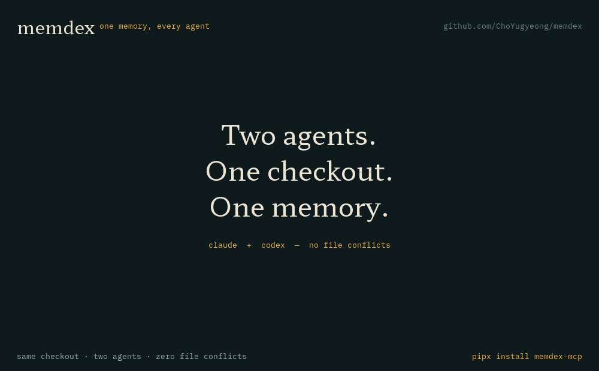

<p align="center">
  
</p>

<h1 align="center">memdex</h1>

<p align="center">
  <b>한 저장소를 같이 쓰는 AI 코딩 에이전트를 위한 핸드오프·작업 장부·메시지.</b><br/>
  SQLite 파일 하나. 의존성 0개. 어떤 MCP 클라이언트든. Claude Code·Codex·Cursor·딥시크가 서로 멈춘 곳에서 이어받습니다. 지난 세션이 어디서 멈췄는지 말하는 걸 잊었어도요.
</p>

<p align="center">
  
</p>

<p align="center">
  <a href="https://github.com/ChoYugyeong/memdex/actions/workflows/ci.yml"></a>
  <a href="https://pypi.org/project/memdex-mcp/"></a>
  
  <a href="LICENSE"></a>
  <a href="https://glama.ai/mcp/servers/ChoYugyeong/memdex"></a>
  <a href="https://mcprush.com/to/memdex-mcp?ref=badge"></a>
</p>

<p align="center">
  <a href="#빠른-시작">빠른 시작</a> ·
  <a href="#에이전트모델-추가하기">에이전트 추가</a> ·
  <a href="#스스로-쓰이는-핸드오프">핸드오프</a> ·
  <a href="#잠금과-공유-체크아웃">잠금</a> ·
  <a href="#도구">도구</a> ·
  <a href="#다른-도구와의-비교">비교</a> ·
  <a href="#한계-도입-전에-읽어-주세요">한계</a> ·
  <a href="#자주-묻는-질문">FAQ</a> ·
  <a href="README.md">English</a>
</p>

---

**memdex는 회사가 다른 코딩 에이전트들이 한 저장소에서 같이 일하게 해 줍니다.** SQLite 파일 하나,
의존성 0개, 클라우드 없음. 세션은 이전 세션이 남긴 것(핸드오프, 열린 작업, 안 읽은 메시지, 누가 무엇을
고치는 중인지)에서 시작합니다. 이전 세션이 어떤 에이전트였든 상관없고, 다시 알아낼 필요가 없습니다.

```bash
pip install memdex-mcp        # PyPI 이름은 memdex-mcp, 명령은 memdex
memdex connect                # claude, codex, cursor, vs code, chatgpt … 자동 연결 (serve-check 포함)
memdex brief                  # 이전 세션이 남긴 것 — 지금 바로 실행해 보세요
```

- **에이전트가 잊어도 세션은 핸드오프로 끝납니다.** `handoff`는 한 일·다음 할 일·결정을 남깁니다.
  Claude Code 세션이 핸드오프 없이 끝나거나 컴팩트되면, 훅이 증거(요청, 에이전트가 고친 파일, 커밋,
  열린 작업, 마지막 메시지)로 초안을 만들고 `(auto)`라고 표시합니다. 다른 에이전트는 `memdex handoff --auto`로 같은 초안을 만듭니다.
- **"끝났다"는 누가 확인하기 전까지 주장입니다.** 작업 장부는 막힘과 증거를 기록하고, *보고됨*, *스스로 확인함*,
  *다른 에이전트가 확인함*을 구분합니다.
- **에이전트끼리 조율합니다.** 수정 중인 파일을 `claim`하거나 잠그고, 다른 에이전트에게 `post`하고, `inbox`를 읽습니다.
  한 저장소의 모든 worktree가 같은 저장소를 씁니다.
- **컨텍스트를 적게 씁니다.** 서버는 기본으로 협업 도구 10개만 내보내고, 안내문과 스키마를 합쳐 요청당
  약 1,300토큰입니다(0.4.2는 약 3,500). 파일 요약, 심볼 찾기, 스킬, AI 검토는 `MEMDEX_TOOLS`로 켭니다.
- **노트가 스스로 낡음을 압니다.** 결정·함정은 근거가 된 파일을 함께 기록하고, 그 파일이 바뀌면 경고가 붙습니다.
  파일 요약은 내용의 sha256에 묶여 있어서 파일이 바뀌기 전까지만 유효합니다.

만든 사람의 에이전트들이 실제로 이렇게 씁니다. 한 컴퓨터에서 처음 19일 동안 Claude Code, Codex, DeepSeek 세션이
**40개 프로젝트에 핸드오프 493개**를 남기고, 메시지 242건을 주고받고, 작업 241개를 장부에 올렸습니다.
`memdex stats`를 실행하면 내 컴퓨터의 같은 수치와, 핸드오프가 실제로 다른 에이전트에게 전달된 횟수가 나옵니다.

## 빠른 시작

```bash
pipx install memdex-mcp        # PyPI 이름은 memdex-mcp, 명령은 memdex
memdex connect --agent claude  # 이 컴퓨터에 설치된 에이전트 설정에 MCP 항목을 직접 씁니다
memdex hook install --claude   # 선택, Claude Code: 잠긴 파일 수정 거부, 빠진 핸드오프 초안 작성
```

**Claude Code** (사용자 범위, 모든 프로젝트) — `claude` CLI가 PATH에 있으면 `memdex connect`가 이 명령을
대신 실행하고, 없으면 출력합니다:

```bash
claude mcp add memdex --scope user -e MEMDEX_AGENT=claude -- memdex serve
```

**설정 파일을 쓰는 나머지 클라이언트** (Claude Desktop, Cursor, VS Code·GitHub Copilot, Windsurf, Zed,
Cline, Gemini CLI, Codex CLI, DeepSeek Harness): `memdex connect`가 설치된 클라이언트만 골라 설정에 `memdex`
항목을 합쳐 넣고, 다른 설정은 보존하며, 쓰기 전에 `.bak`을 남깁니다. `--list`는 아무것도 쓰지 않고 상태만
보여 주고, `--dry-run`은 쓸 내용만, `--remove`는 항목을 다시 뺍니다. 클라이언트별 세부 사항, DeepSeek Harness
프로필, 저장소에 넣는 팀 설정은 [에이전트·모델 추가하기](#에이전트모델-추가하기)에 있습니다.

**`--serve-check`**는 설정의 마지막 확인입니다. 방금 쓴 항목으로 서버를 직접 띄워 MCP 핸드셰이크
(initialize → `tools/list`)를 해 보고, 경로가 틀렸거나 인터프리터가 없거나 DB를 못 열면 에이전트에
들어가기 전에 여기서 잡습니다:

```text
+ serve-check      memdex answered: 10 tools, protocol 2024-11-05
```

**손으로 넣거나**, memdex가 모르는 클라이언트라면:

```json
{ "mcpServers": { "memdex": { "command": "memdex", "args": ["serve"], "env": { "MEMDEX_AGENT": "codex" } } } }
```

에이전트마다 다른 `MEMDEX_AGENT` 이름을 줍니다. 전체 id는 `이름@체크아웃폴더`(예: `claude@myrepo-wt`)가 됩니다.
`memdex config --agent <이름>`이 위 설정과, 세션 시작 때 브리핑을 자동으로 넣어 주는 Claude Code `SessionStart` 훅을 출력합니다.

끝입니다. 서버가 MCP `initialize` 응답에 사용법을 실어 보내므로, 에이전트는 별도 프롬프트 없이도 흐름을
압니다. 시작할 때 `project_brief`, 고치기 전에 `claim`, 큰 작업은 `tasks`, 대화는 `post`/`inbox`, 끝날 때 `handoff`.

## 에이전트·모델 추가하기

MCP 지원 여부와 상관없이 모든 에이전트는 같은 네 단계로 루프에 합류합니다:

1. **이름을 줍니다.** `MEMDEX_AGENT`가 id가 됩니다(`이름@체크아웃폴더`). 같은 이름을 쓰는 두 에이전트는
   서로의 메시지를 볼 수 없으니, 각자 다른 이름을 주세요.
2. **연결합니다.** MCP 클라이언트는 명령 하나(아래 표). 셸 명령만 실행할 수 있는 모델은 연결할 것이 없습니다.
3. **확인합니다.** `memdex doctor`(`✓ clients`), Codex는 `codex mcp list`, 핸드셰이크는
   `memdex connect --serve-check`, 그 외에는 `memdex whoami`.
4. **일합니다.** 기본 흐름은 `brief`, `claim`, `post`/`inbox`, `handoff`입니다. 빠뜨리기 쉬운 결과가 여러 개인 큰 작업은 시작 전에 `tasks` 트리로 나눠 막힌 가지와 미완료 항목을 드러냅니다.

`MEMDEX_AGENT`는 직접 정하는 이름표이며 인증된 신원이 아닙니다. `verified`는 다른 이름표가 동료 검토를
기록했다는 협업 신호이지, 실제 검토자를 암호학적으로 증명하지는 않습니다.

오래 실행할 감시 프로세스는 `inbox --follow --poll 2 --notify-every 900`처럼 설정할 수 있습니다.
2초마다 메시지를 확인해도 읽음 처리하지 않고, 15분마다 한 번에 출력합니다. 출력 버퍼를 비운 뒤 읽음
커서를 옮기므로 그 사이 프로세스가 종료되면 번호가 붙은 메시지가 다시 보일 수 있지만 사라지지는 않습니다.
스케줄러가 확인할 때마다 새 프로세스를 띄운다면 `inbox --notify-every 900`을 사용하세요. 프로젝트와
에이전트별 알림 시각을 저장하므로 첫 확인에서 15분 창을 열고, 그동안 반복 확인해도 메시지를 읽음 처리하지
않으며, 시간이 되면 모인 메시지를 한 번에 전달합니다. 매번 같은 에이전트 이름, 프로젝트 경로, 간격을
사용하세요. MCP `inbox` 도구도 같은 방식으로 `notify_every` 초를 받습니다.

| 에이전트 / 모델 | 합류 방법 | 확인 |
|---|---|---|
| Claude Code | `memdex connect`(`claude mcp add …` 실행) + `SessionStart` 훅 | `claude mcp list` |
| Codex CLI | `memdex connect` → `~/.codex/config.toml`의 `[mcp_servers.memdex]` | `codex mcp list` |
| DeepSeek Harness | `memdex connect --client deepseek-harness --agent deepseek --serve-check` | 새 세션에서 `project_brief` 호출 |
| Claude Desktop, Cursor, VS Code, Windsurf, Zed, Cline, Gemini CLI | `memdex connect`가 각 설정 파일에 키 하나씩 기록 | `memdex doctor` |
| ChatGPT Desktop | 앱 UI: 설정 → MCP → 서버 추가(명령 `memdex`, 인자 `serve`, 환경 `MEMDEX_AGENT=gpt`); 파일이 생긴 뒤엔 `memdex connect`가 관리 | 앱의 MCP 패널 |
| **셸 명령만 실행할 수 있는 모든 모델** — 로컬 LLM, 래퍼 스크립트, 다른 하네스 | 연결 불필요: `MEMDEX_AGENT`만 주고 조율 명령 사용 | `memdex whoami` |

```bash
# MCP 클라이언트가 없는 모델도 10초면 합류
MEMDEX_AGENT=codex memdex brief                    # 이전 세션이 남긴 것
MEMDEX_AGENT=codex memdex claim src/store.py --intent "add retry"
MEMDEX_AGENT=codex memdex task create --title "재시도 지원" --criterion "재시도가 제한되고 확인됨"
MEMDEX_AGENT=codex memdex task create --parent 1 --title "재시도 구현" --criterion "재시도 경로가 동작" --owner codex
MEMDEX_AGENT=codex memdex post "재시도 작업 진행 중" --group --to claude --task 1
MEMDEX_AGENT=codex memdex handoff "retry 완료" --next "timeout 연결"
```

### DeepSeek Harness

`memdex connect --client deepseek-harness --agent deepseek --serve-check`로 설정한 뒤 새 Harness 세션을
시작합니다. 프로필의 `cordis.patch.yml`에 표시된 `@deepseek-ai/dsh-mcp-client` 블록만 추가·갱신·삭제합니다.
`--serve-check`는 memdex의 MCP `initialize`와 `tools/list` 응답을 확인할 뿐, Harness가 플러그인을 불러왔다는
뜻은 아닙니다. 새 세션에서 `mcp__memdex__...` 도구가 보이는지 확인하고 `project_brief`를 호출해야 연결
완료입니다. MCP 항목은 `connect`를 실행한 것과 같은 Python 패키지를 쓰고, 프로필의 작업 디렉터리를 프로젝트
범위로 씁니다. `id: memdex-memory`를 이미 수동으로 쓰거나, 최상위 YAML 목록이 아니거나, ID가 겹치는 프로필
설정은 자동으로 바꾸지 않고 검토 대상으로 남깁니다.

Harness 프로필이 여러 개면 `connect`는 쓰기 전에 멈추고 대상을 지정하라고 안내합니다:
`memdex connect --client deepseek-harness --profile desktop --agent deepseek --serve-check`. 프로필 이름은
`~/.dsh/profiles`(또는 `$DSH_HOME/profiles`) 아래 디렉터리 이름이며, `memdex connect --list`에서 경로를
확인할 수 있습니다. 설치된 모든 프로필에 무심코 서버를 추가하지 않도록 하나를 명시해야 합니다.

### memdex가 쓰는 설정 파일

대부분은 `mcpServers.memdex`, VS Code는 `servers.memdex` + `type: stdio`, Zed는 `context_servers.memdex`,
Codex는 `[mcp_servers.memdex]`입니다. 설치되지 않은 클라이언트의 설정 폴더는 만들지 않고, 해석할 수 없는
JSON/TOML 파일은 손대지 않습니다. Zed의 settings.json은 주석을 허용하는데 다시 쓰면 주석이 사라지므로, 주석이
있는 파일은 덮어쓰지 않고 붙여 넣을 블록만 출력합니다.

### 팀 범위

저장소 안에 설정을 넣어, 클론한 사람 모두가 memdex를 갖게 합니다:

```bash
memdex connect --project     # .vscode/mcp.json, .mcp.json (커밋해도 되도록 `memdex`만 적음)
```

커밋되는 설정에는 이 컴퓨터의 절대경로를 넣을 수 없어서, 프로젝트 범위는 `command`를 `memdex`로 씁니다.
동료의 PATH에 `memdex`가 있어야 하므로 `pipx install memdex-mcp`를 안내하세요. `claude` CLI가 있고
`--project`를 쓰면 `.mcp.json`은 CLI가 직접(`claude mcp add memdex --scope project …`) 쓰고 memdex는
VS Code 파일만 씁니다. 한 파일을 두 주인이 건드리지 않게 하기 위해서입니다. `--no-claude`는 CLI를 건너뛰고,
`--client claude-code`는 그 단계만 실행합니다.

### 특정 대화에 보내고 답장받기

작업을 맡길 때는 **채팅 고유 ID·프로젝트·명시적인 작업 ID**를 확인하세요. 제목/라벨은 검색 단서입니다.
참여하는 각 채팅 안에서 `memdex session routes --task-id 17 --label "라우팅 검토"`로 같은 프로젝트의
열린 작업 17번을 연결하고, `memdex post "검토 부탁합니다" --to route:<주소> --task-id 17`로 보냅니다.
미지정/다른 작업에 연결된 수신자는 거절합니다. 최근에 활동했거나 idle이라는 이유로 새 일을 맡기면 안 됩니다.

원하는 DeepSeek 대화 안의 셸에서 `memdex session routes --label "세션 라우팅 검토"`를 실행하세요.
Memdex는 셸의 `DSH_SESSION_ID`로 그 대화의 주소를 만듭니다. Codex 셸에서는 `CODEX_THREAD_ID`를 씁니다.
두 쪽이 같은 프로젝트를 가리켜야 합니다. 필요하면 양쪽 명령에 `--path <저장소>`를 지정하세요.

보내는 쪽에서 `memdex session routes --query "세션 라우팅 검토"`로 작업명과 체크아웃을 확인한 뒤
`memdex post "검토 부탁합니다" --to route:<주소>`로 보냅니다. 받는 대화에서 `memdex inbox`로 읽고
`memdex post "검토했습니다" --reply-to 42`처럼 실제 받은 메시지 번호로 답장하세요.
검색어에 에이전트 이름과 작업 단어를 함께 넣을 수 있습니다. 예를 들어 `--query "deepseek 배포"`는
두 단서가 모두 맞는 후보를 찾습니다. 한글의 완성형과 조합형은 같은 단서로 취급합니다.
검색 결과가 여러 대화에 걸치거나 최근 10분 동안 등록 갱신이 없으면 목적지 주소를 가립니다.
진행 중인 대화는 그 안에서 등록 명령을 다시 실행해 주소를 확인하세요. 새 작업은 새 대화를 열어 등록할 수 있습니다.
이미 주소를 아는 상대에게 보낸 메시지는 그 대화가 돌아올 때까지 기다립니다.

전송을 재시도할 수 있는 클라이언트는 첫 전송 **전에** 고유한 요청 키를 정해 둡니다.
예를 들어 `memdex post "검토했습니다" --reply-to 42 --request-key review42-attempt-a8b2`의 응답을
잃으면 같은 명령과 키로 재시도하세요. 원본 메시지가 DB에 있는 동안 같은 발신 대화는 기존 메시지 번호를
돌려받습니다. 본문이나 목적지를 바꾸면서 같은 키를 쓰면 거부됩니다. 별개의 전송에는 새 키를 씁니다.
MCP 도구의 인자 이름은 `request_key`입니다.

MCP에서는 `session_routes`와 `post(reply_to=...)`를 씁니다. 공용 서버를 쓰는 호스트는 호출마다
`params._meta["memdex.dev/conversation-id"]`에 대화 ID를 제공할 수 있습니다. 이 정보가 없는
DeepSeek MCP에서는 해당 대화의 셸을 쓰세요. 주소는 같은 사용자 계정 안에서 오배송을 방지하는 용도입니다.
이전 이름 우편함에 의도적으로 보내려면 `--group --to <이름>`을 사용합니다.

### 선택: 배정된 작업 깨우기

OS 스케줄러에서 `python -m memdex.assigned_wake --workspace /신뢰하는/작업공간/경로`를 실행합니다. 확인만 할 때는
AI 세션을 띄우지 않습니다. 프로젝트에 작업이 연결된 안 읽은 메시지가 있고, 그 작업이 아직 해당 에이전트에게
배정된 todo 상태이며, 최근 10분 안에 맞는 세션이 없을 때만 로컬에 설치된 Claude 또는 Codex CLI를 띄웁니다.
예를 들어 작업 42의 담당자에게 알리려면 `memdex post "검토 부탁해요" --to gpt --group --task 42`. 동시 확인이나
재시작으로 대화가 중복되지 않도록 띄우기 전에 작업을 예약하며, 예약 뒤 실행이 실패하면 사람이 확인해야 합니다.
작업공간마다 디스패처는 하나만 설정하세요.

## 스스로 쓰이는 핸드오프

핸드오프는 있어야 도움이 되는데, 에이전트는 자주 빼먹습니다. 컨텍스트가 바닥나거나, 창이 닫히거나, 작업이
그냥 끝나 버립니다. 그래서 memdex가 모델을 부르지 않고, 관찰할 수 있는 것만으로 초안을 만듭니다.

```bash
memdex hook install --claude     # Claude Code: SessionEnd·PreCompact에서 `memdex hook session-end` 실행
memdex handoff --auto            # 어떤 에이전트든 셸에서, 멈추기 전에 (--since 2h로 범위 지정)
```

```text
last handoff #41 (claude@shop, 2h ago):
Next: Open tasks: #7 [in_progress] Move checkout to the new tax API. Uncommitted: src/tax.py, tests/test_tax.py.
Done: (auto) session ended without a handoff; drafted from evidence, not vouched for by the agent.
Asked: "Move checkout to the new tax API" Edited: src/tax.py, tests/test_tax.py. Last message: "Two tests
still fail on rounding; see test_tax.py::test_half_cent."
```

- **근거.** 훅은 호스트가 넘겨주는 세션 기록에서 첫 요청과 가장 최근 요청, 에이전트의 마지막 말, 편집 도구로
  고친 파일을 읽습니다. git에서는 커밋하지 않은 경로와 세션 시작 뒤 그 저장소에 생긴 커밋을 가져옵니다(누가
  했는지는 구분하지 못합니다). memdex에서는 그 에이전트의 열린 작업·claim·저장한 결정과 함정을 가져옵니다.
- **작업한 곳에 남습니다.** 저장소들의 상위 폴더에서 시작한 세션은 초안을 실제로 고친 저장소마다 남깁니다
  (자기 프로젝트 외에 최대 3곳). 경로는 그 저장소 기준이고, 함께 고친 다른 프로젝트를 한 줄로 알려 줍니다.
  한 저장소의 worktree는 모두 그 저장소로 봅니다. 임시 폴더처럼 어느 프로젝트에도 속하지 않는 곳의 편집은 뺍니다.
- **에이전트의 핸드오프를 덮지 않습니다.** 그 세션에서 에이전트가 직접 핸드오프를 썼으면 초안을 만들지 않습니다.
  그 뒤에 편집을 계속했다면 그 뒤의 작업만 초안으로 남깁니다. 읽고 답하기만 한 세션은 아무것도 남기지 않고,
  같은 세션의 두 번째 초안은 첫 번째를 대체합니다. 다른 세션의 초안은 건드리지 않으므로, 한 저장소에서 두
  세션이 일했다면 각자의 초안이 남습니다.
- **무엇인지 밝힙니다.** 초안에는 `(auto)`와 "에이전트가 보증하지 않음"이 붙습니다. 완료가 아니라 증거를 알립니다.
  claim은 해제하지 않고 만료되게 둡니다.
- **빼는 것.** 비밀처럼 보이는 경로(`.env`, 키)는 빼고, 인용문 안의 토큰 모양 문자열은 가립니다. 인용은 수백 자로
  자릅니다. 핸드오프는 공유·내보내기가 되는 노트이므로, 민감하다면 에이전트가 하는 말을 확인하세요.
  `MEMDEX_AUTO_HANDOFF=0`으로 끕니다.
- **한계.** 고친 파일은 편집 도구 호출에서 가져옵니다. 셸 명령으로 바꾼 파일은 *Uncommitted*에만 나오고,
  거기에는 같은 체크아웃의 다른 에이전트 작업도 함께 보입니다. 아주 긴 기록은 앞부분과 뒷부분만 읽습니다.
  세션 중에 같은 에이전트가 그 저장소에 쓴 핸드오프는, 다른 세션이 쓴 것이라도 자기 것으로 봅니다.
  훅은 지금 Claude Code만 지원하고, 다른 에이전트는 `handoff --auto`를 씁니다.

그 뒤의 일은 `memdex stats`가 셉니다. 핸드오프가 쓰지 않은 에이전트에게 보인 횟수와, 같은 에이전트가 나중
세션에서 이어받은 횟수입니다.

## 잠금과 공유 체크아웃

서로 협조하는 에이전트끼리는 일반 claim으로 충분하지만, `git commit`은 막지 못합니다. 두 명령이 그 틈을
메웁니다.

```bash
memdex claim src/store.py --exclusive --intent "재시도 루프 재작성"
memdex hook install
```

`--exclusive`는 claim을 잠금으로 만듭니다. 그 경로에 대한 다른 에이전트의 claim이 거부되고, 잠금이 살아
있는 동안 그들의 커밋도 거부됩니다. `--force`를 주면 잠금을 무시하고 기록하며, 상대에게 그 사실을 알립니다.
모든 claim은 만료되므로 세션이 죽어도 영원히 잠기지 않습니다.

`memdex hook install`은 `.git/hooks/pre-commit`에 `memdex hook pre-commit`을 부르는 작은 `sh` 스크립트를
심습니다. 스테이징된 파일만 검사하고, 로컬 DB만 읽습니다.

```
$ git commit -m "재시도 루프"
memdex: commit blocked — these staged files are locked by another agent:
  src/store.py  ←  claude@memdex (재시도 루프 재작성, 41m left)
```

일반 claim은 커밋을 막지 않고 안내만 출력합니다. 낡은 잠금이라고 확신하면
`MEMDEX_ALLOW_LOCK=1 git commit …`으로 건너뛸 수 있고, memdex가 만들지 않은 훅은 `hook install --force`로
교체합니다.

그런데 커밋 시점은 늦습니다. 그때는 이미 파일이 바뀐 뒤니까요. 도구 실행 전 훅이 있는 하네스라면 **편집
자체를** 막을 수 있습니다. Claude Code는 `PreToolUse` 훅을 제공합니다.

```bash
memdex hook install --claude            # ~/.claude/settings.json
memdex hook install --claude --project  # ./.claude/settings.json
```

```json
{"hooks": {"PreToolUse": [{"matcher": "Edit|Write|MultiEdit",
  "hooks": [{"type": "command", "command": "memdex hook pre-edit --agent claude"}]}]}}
```

같은 명령이 `memdex hook session-end`를 실행하는 `SessionEnd`·`PreCompact` 훅도 설치합니다.
[자동 핸드오프](#스스로-쓰이는-핸드오프)를 참고하세요.

이 훅은 Claude Code가 stdin으로 주는 JSON에서 `tool_input.file_path`를 읽어 프로젝트 상대 경로로 바꾸고,
다른 에이전트가 그 파일을 exclusive claim으로 잡고 있으면 **exit 2**(차단, stderr는 모델에게 전달)로
멈춥니다.

```
blocked: locked by deepseek@memdex (refactor, 40m left) — post to them or claim --force
```

일반 claim이면 안내만 출력하고 편집은 통과합니다. 프로젝트 밖 경로는 무시하고, `MEMDEX_ALLOW_LOCK=1`로
우회할 수 있습니다. 설치 프로그램은 기존 `settings.json`에 **병합**하며(변경 전 `.bak` 백업), 읽을 수 없는
파일은 건드리지 않습니다. `memdex config`도 같은 스니펫을 출력합니다.

잠금은 **번호가 붙은 임차(lease)** 입니다. 모든 부여는 fencing token과 그 시점 파일의 sha를 함께 기록하므로,
잠금이 이전 것과 구분되고 **낡은 읽기로 계산한 편집은 덮어쓰지 않고 거부**됩니다:

```
blocked: src/store.py changed since you claimed it (token 7, sha 3adeaf13 → b71f0c92).
Re-read the file, then re-stamp the lock:
  memdex claim src/store.py --exclusive --refresh
```

`--refresh`는 내가 이미 가진 잠금만 다시 도장 찍습니다(새 토큰, 현재 sha). 새 잠금을 잡지도, 남의 잠금을
덮지도 않습니다.

## 도구

기본으로 보이는 도구 — 협업 루프:

| 도구 | 언제 | 무엇을 받나 |
|---|---|---|
| `project_brief` | 세션 시작 | 마지막 핸드오프, 안 읽은 메시지, 다른 에이전트의 claim, 열린 작업, 고정 노트. `task`를 주면 관련 노트로 좁힘. 색인도 갱신. |
| `claim` | 수정 전 | 경로를 N분간 선언하거나 `exclusive`로 잠금. 다른 에이전트의 겹치는 claim을 경고. |
| `tasks` | 여러 결과가 필요한 큰 작업 | 계층형 결과, 담당자, 차단 사유, 증거, 보고/검증 상태. 하위 작업이 확인되기 전에는 부모를 보고할 수 없음. |
| `post` / `inbox` | 메시지 주고받기 | 특정 대화 주소로 보내거나 받은 메시지 번호로 답장. 안 읽은 메시지 읽기, 묶어서 받기도 가능. |
| `session_routes` | 대화 찾기 | 대화 주소, 체크아웃, 명시적 `task_id`, 작업명, 마지막 접속 시각. 작업 배정은 `task_id`로 묶고, 작업명은 찾기 힌트일 뿐. |
| `handoff` | 세션 끝, 또는 컨텍스트가 모자랄 때 | 한 일 / 다음 / 결정 / 함정과 원장의 미완료 항목. claim도 해제. |
| `remember` / `note` | 뻔하지 않은 것을 알았을 때 | `note`·`decision`·`pitfall`·`todo` 저장/읽기/확인/고정/보관, 파일 연결 가능. |
| `search` | 처음부터 탐색하기 전 | 노트·핸드오프·요약·파일을 키워드와 선택적 로컬 임베딩으로 검색. |

`MEMDEX_TOOLS`로 켜는 도구:

| 도구 | 그룹 | 무엇을 받나 |
|---|---|---|
| `file_summary` / `file_summary_save` | `code` | 내용이 그대로면 캐시된 2~6줄 요약, 아니면 옛 요약(낡음 표시)과 무료 개요. 저장하면 내용 해시에 묶여 모든 에이전트와 공유. |
| `where_is` | `code` | `경로:줄 종류 이름` 목록. |
| `read_snippet` | `code` | `query`나 `line` 주변의 제한된 조각. |
| `skills` | `skills` | 이 컴퓨터에서 공유하는 스킬. 해시·위험 사전 점검을 먼저 하고, 승인 전 지시문은 숨김. |
| `review` / `review_status` | `review` | 승인된 독립 AI 검토. 고른 프로젝트 파일의 스냅숏을 지정한 검토자에게 한 번 보내고, 결과를 요청한 대화의 받은편지함으로 돌려줌. |
| 고급 인자 | `full` | `search`의 cues, `as_of` / `valid_at`, `lang` / `path`, 구조화된 `experience` 노트. |

응답은 짧은 일반 텍스트입니다. 바이트 하나하나가 토큰입니다.

**요청마다 붙는 비용.** 대부분의 클라이언트는 서버 안내문과 목록에 오른 도구 스키마를 매 요청에 함께 보냅니다.
그래서 memdex는 기본으로 핵심 10개만 평소 쓰는 인자와 함께 내보냅니다. 합쳐서 약 1,300토큰이고, 0.4.2는 약
3,500토큰이었습니다. 목록에 없는 도구도 호출은 되고, 모든 기능은 CLI에 그대로 있습니다. `memdex doctor`가
지금 개수와 비용을 보여 줍니다.

```bash
MEMDEX_TOOLS=code,skills   # 핵심에 그룹(code, skills, review)이나 도구 이름을 더함
MEMDEX_TOOLS=full          # 고급 인자(as_of, valid_at, experience 필드 등)도 공개
MEMDEX_TOOLS=all           # 0.4처럼 모든 도구·인자
memdex connect --tools code     # 각 클라이언트 설정에 MEMDEX_TOOLS를 기록
```

하위 작업은 부모 목표를 끝내는 데 꼭 필요한 결과일 때만 붙이고, 별개 목표는 각각 최상위 작업으로 둡니다. 작업
원장은 진실을 자동 판정하지 않습니다. 증거는 에이전트가 제공하며, 자기 확인과 다른 에이전트의 확인을 따로
표시합니다. 스스로 확인한 작업도 나중에 다른 에이전트가 확인하면 교차 확인 상태로 올라갑니다. 작업은 로컬 SQLite에만 저장되고 노트 동기화에는 포함되지 않습니다.

## 한 화면에서 여러 AI의 협업 보기

**Memdex Studio**는 Electron 창에서 **QA 스튜디오**를 엽니다. Windows ZIP의 압축을 풀고 `Memdex-Studio.exe`를 더블클릭하세요. 상단에서 프로젝트를 선택하면 저장된 프로젝트 키를 기준으로 메시지·작업·세션이 함께 나타납니다. 같은 Git 저장소의 worktree는 한 그룹에 속합니다. 작업 폴더를 선택하면 그 폴더의 파일로 검토할 수 있고, **터미널**을 누르면 해당 폴더에 셸이 열립니다. 프로젝트를 오가도 각 셸은 유지되며, 삭제된 폴더의 메시지도 기록으로 볼 수 있습니다.

소스 체크아웃에서는 Node.js 22.12 이상과 Python으로 Electron을 한 번 준비하고 현재 프로젝트를 엽니다.

```sh
cd studio
npm ci
npx install-electron
cd ..
python -m memdex board --desktop
```

Studio는 데스크톱 버전과 `studio-v*` 태그를 별도로 관리합니다. `python packaging/windows/build.py --studio-dist dist/studio`로 버전이 붙은 Windows ZIP과 SHA-256 검증 파일을 만듭니다. [Studio 빌드·릴리스 절차](docs/studio-release.ko.md)

웹 브라우저에서도 같은 보드를 열 수 있습니다.

```sh
memdex board --web
```

- **탐색기**에서 작업을 선택하면 하위 작업까지 포함한 메시지가 보입니다. AI 세션을 선택하면 해당 채팅이 직접 보내거나 받은 메시지로 좁힙니다.
- **메시지**에는 발신자, 수신자, 작업 번호와 답장 대상이 표시됩니다. `/`로 불러온 미리보기를 검색하고, ‘이전 메시지 더 보기’로 기록을 거슬러 올라갈 수 있습니다.
- **대화 흐름**에서는 선택한 메시지의 원문, 같은 대화의 답장들, 발신 당시 첨부된 작업 기록을 읽을 수 있습니다.
- **QA 스튜디오**에서 열린 작업을 선택하거나 새로 만들고, 검토 스킬과 파일, 질문을 한 번 지정하세요. **세 모델에 검토 요청**을 누르면 Claude Code, 로컬 Ollama의 Qwen, DeepSeek Harness가 같은 입력을 검토합니다. 각 패널에 상태와 답변이 표시됩니다.

예를 들어 수신함 QA라면 작은 테스트 파일을 추가하고 “미리보기 후에도 일반 읽기에서 같은 메시지를 한 번 받을 수 있나요?”라고 입력하세요. 한 모델의 연결만 실패했을 때는 해당 패널의 **이 모델만 재시도**를 누릅니다. 재시도는 원래 worktree의 파일과 스킬 버전이 일치할 때 진행됩니다. 답변 아래에 반영한 변경과 테스트 결과를 입력해 **작업에 기록**하면 답장 번호와 함께 작업 이력에 남습니다. 지난 실행은 **검토 기록**에서 다시 열 수 있습니다.

기본 코드 검토는 바로 사용할 수 있습니다. 등록 스킬을 선택하려면 `memdex skills scan` 후 `memdex skills inspect 이름`, `memdex skills approve 이름`으로 번들을 확인·승인하세요. 선택한 `SKILL.md` 본문을 읽기 전용 검토 지침으로 전달합니다. 각 모델은 기존 CLI 로그인 또는 설치된 Ollama 모델을 사용합니다. HTML 스냅샷에서는 저장된 비교 결과를 열람할 수 있습니다.

같은 Git 저장소의 worktree에서 같은 Memdex DB를 쓰면 Claude, Codex, Qwen, DeepSeek가 Memdex로 주고받은 메시지가 한곳에 모입니다. 보드는 2초마다 갱신되며, 읽어도 수신함의 읽음 상태는 유지됩니다. 로컬 서버는 터미널에서 `Ctrl+C`로 종료합니다.

터미널에서는 `memdex board --watch`로 실시간 보기를 열 수 있습니다. 서버 없이 보려면 `memdex board --html workspace.html`로 새 파일을 만들어 브라우저로 여세요. 이 파일에는 내보낸 시점의 프로젝트 메시지 전문이 포함됩니다.

Orca에서 사용하려면 프로젝트를 열고 활성 터미널에서 다음 명령으로 보드를 옆에 띄우세요. 각 AI의 자체 채팅은 원래 창에서 보고, Memdex를 통해 공유한 대화는 보드에서 따라갈 수 있습니다. [Orca CLI 문서](https://github.com/stablyai/orca/blob/main/skill-guides/orca-cli.md#terminals)

```sh
orca terminal split --direction vertical --command "memdex board --watch" --json
```

## CLI

도구가 하는 일은 전부 명령으로도 됩니다. 셸만 쓰는 에이전트, 훅, 사람을 위한 것입니다.

```bash
memdex brief --agent codex              # 세션 시작
memdex brief --task "청구서 정산 수정"  # 이 작업의 공유 노트와 파일 요약부터 가져오기
                                      # 호스트 채팅 ID가 있으면 작업명도 자동 등록
memdex file src/store.py                # 캐시된 요약 + 개요
memdex file src/store.py --summary "…"  # 요약 저장
memdex snippet src/store.py --query "def index"
memdex where_is index                   # 심볼 정의 위치
memdex search "locked"
memdex search "재시도 정책 변경 이유" --cue "backoff 결정" --cue "이전 timeout" --as-of 2026-10-15
memdex search "TLS 인증서 정책" --valid-at 2024-05-01
memdex remember pitfall "WAL 모드 필요" --body "…" --files src/store.py
memdex remember decision "sqlite만 쓴다" --importance 3 --pin
memdex remember experience "wheel 빌드 복구" --outcome success --context "오래된 빌드 캐시" --step "캐시 삭제" --step "깨끗한 venv에서 빌드" --evidence "wheel 설치 성공"
memdex eval                              # 합성 질의 회상 측정 + 자연어 질문을 벡터 켬/끔으로 비교
memdex task create --title "DeepSeek MCP 추가" --criterion "MCP 도구가 보임" --owner codex
memdex task create --title "포트폴리오 압축" --criterion "요청 페이지가 확인됨" --owner codex
memdex task block 1 --reason "연결 플러그인이 없음; 포트폴리오는 계속 가능"
memdex task list                         # DeepSeek는 차단, 포트폴리오는 별도로 표시
memdex task start 2
memdex task report 2 --evidence "output/portfolio.pdf에 초안 저장"
memdex task verify 2 --agent reviewer --evidence "PDF를 열어 요청된 페이지를 모두 확인"
memdex claim src/store.py --intent "리팩터링"
memdex claim src/store.py --exclusive  # 잠금: 다른 에이전트의 claim이 거부됩니다
memdex post "압축 작업 진행 중" --group --to claude --task 2
memdex inbox
memdex inbox --follow                    # 다음 메시지가 올 때까지 대기 (우편함 폴링, --timeout N)
memdex inbox --follow --poll 2 --notify-every 900  # 2초마다 확인하고 15분마다 모아 전달
memdex inbox --notify-every 900          # 짧은 주기 실행: 상태를 저장하고 15분마다 묶어 전달
memdex whoami                            # 나는 누구고 어느 체크아웃인지, 뭐가 기다리는지 (인덱스 패스 없이)
memdex session list                      # 살아 있는 세션 목록 (브리프가 하트비트)
memdex wake --agent claude --command "claude -p 'check the brief'"   # 기다리는 일이 있으면 새 세션 열기
memdex contradictions                    # 서로 반대로 주장하는 노트 — 편집 전에 정리하세요
memdex digest                            # 같은 말을 두 번 하는 노트 묶음 (통합용)
memdex skills suggest docs/*.docx deck/  # 지금 만질 파일에 맞는 공유 스킬 찾기
memdex skills recommend office slides    # 이 프로젝트의 스킬 → .memdex/skills.json (커밋해서 공유)
memdex note 7                            # 읽기
memdex note 7 --confirm                 # 지금도 유효: 참조 재도장, ⚠ 제거
memdex note 7 --pin                     # 브리핑 맨 위에 고정
memdex note 7 --archive                 # 노트 읽기, 또는 보관
memdex handoff "X 완료" --next "Y" --pitfalls "Z"
memdex index                            # 현재 프로젝트 색인 갱신
memdex export --out notes/              # 노트를 마크다운 파일로
memdex export --sync ../shared          # 노트·요약을 JSON으로 (다른 컴퓨터로 옮길 때)
memdex merge ../shared                  # 다른 컴퓨터가 export한 것을 적용 (updated_at 기준 LWW)
memdex digest                           # 같은 말을 하는 노트들 → 에이전트가 통합
memdex import                           # AGENTS.md / CLAUDE.md를 노트로 읽기 (콜드 스타트)
memdex stats
memdex bench                            # 이 저장소에서 개요가 아끼는 토큰 측정
memdex prune --dry-run                  # 사라진 프로젝트의 색인 행 정리(미리보기)
memdex doctor                           # DB·스키마·색인·선택 기능 점검
memdex doctor --serve-check             # …서버를 띄워 MCP 핸드셰이크까지 확인
memdex connect --agent claude           # 설치된 클라이언트 설정에 MCP 항목 쓰기
memdex connect --client deepseek-harness --profile desktop --agent deepseek  # Harness 프로필 하나 선택
memdex hook install                     # git pre-commit: 잠긴 파일 커밋 거부
memdex skills                           # 이 컴퓨터의 에이전트들이 공유하는 스킬
memdex skills scan                      # SKILL.md 파일을 다시 읽어 등록
memdex skills verify                    # 번들 해시·참조 파일·승인·위험 패턴 점검
memdex skills show deploy               # 사전 점검표; 승인 전 지침은 숨김
memdex skills inspect deploy            # 로컬에서 사람이 스킬 번들을 검토
memdex skills approve deploy            # 검토 후 정확한 SHA-256을 대화형으로 승인
```

스킬을 따르기 전 `skills show`에서 범위, 요청 도구, 번들 해시, 로컬 참조 파일과 위험 표식을 확인하세요.
설명과 실행 힌트도 신뢰할 수 없는 데이터로 취급합니다.
승인 전 MCP에는 지침을 돌려주지 않습니다. 사람이 `skills inspect`로 내용을 검토하고 `skills approve`에서
정확한 해시를 입력하면 해당 번들만 승인됩니다. 참조 파일이 바뀌면 승인이 무효가 됩니다. 누락·민감 파일·심볼릭 링크·폴더 밖·지원하지 않는 유형·크기 초과 참조는 승인되지 않습니다. 에이전트도 작업에
맞는 스킬인지 확인해야 합니다. 정적 패턴 검사는 안전을 보장하지 않으며, 원격 링크는 목록만 표시하고 가져오지
않습니다. 직접 공유한 레시피는 검증할 파일이 없습니다.

## 동작 원리

```text
          에이전트 (Claude Code, Codex, Cursor, DeepSeek, …)
               │ MCP stdio        │ CLI
               ▼                  ▼
        ┌──────────────── memdex ────────────────┐
        │ project_brief · file_summary · where_is │
        │ read_snippet · search · remember        │
        │ handoff · post/inbox · claim            │
        ├─────────────────────────────────────────┤
        │ 증분 색인            개요 + 심볼         │   크기·수정시각이 바뀐
        │ (stat → sha256)      (regex/ast, LLM 無) │   파일만 다시 읽음
        ├─────────────────────────────────────────┤
        │ sha256에 묶인 요약                       │   내용이 바뀌기 전까지 유효
        │ 파일 참조가 있는 노트 → 낡음 표시        │
        │ 메시지, 읽음 커서, 만료되는 claim        │
        │ 작업 트리 · 차단 사유 · 확인 증거          │
        ├─────────────────────────────────────────┤
        │ SQLite WAL · FTS5 trigram · 벡터        │   ~/.memdex/memdex.db
        └─────────────────────────────────────────┘
```

| | 무엇을 하나 | 가져온 발상 |
|---|---|---|
| **에이전트 조율** | 만료되는 `claim`, 에이전트별 `post`/`inbox`, `handoff`, 그리고 막힌 이유·확인 증거·보고/검증 상태를 보존하는 계층형 작업 원장. | [unlazy](https://github.com/Leonxlnx/unlazy)의 Depth Tree 착상. 셸 실행기와 훅은 가져오지 않음 |
| **내용 해시 요약 캐시** | 요약은 파일의 sha256 아래 저장됩니다. 다른 worktree·브랜치의 같은 내용은 요약을 공유하고, 바뀐 내용에는 "아직 요약 없음, 옛 요약과 개요는 이것"이 나옵니다. | 내용 주소 저장소 |
| **증분 색인** | `git ls-files`(`.gitignore` 존중) 뒤, 크기나 수정시각이 바뀐 파일만 읽습니다. 800개 파일 저장소 재색인이 약 0.2초입니다. | [Everything](https://www.voidtools.com/)의 USN 저널 방식 |
| **개요 + 심볼 지도** | 독스트링/첫 주석과 클래스·함수·줄 번호를 30여 언어에서 뽑습니다(파이썬은 `ast`, 나머지는 언어별 정규식 — tree-sitter나 파서 설치 없음). `where_is`가 grep 반복을 대신합니다. | Serena / repo map |
| **부분 읽기** | `read_snippet`은 파일 전체 대신 검색어나 줄 번호 주변 약 256토큰만 돌려줍니다. | [Kensaku](https://github.com/yjid/kensaku) |
| **다중 단서 하이브리드 검색** | FTS5, RM3-lite 확장, 선택적 로컬 임베딩과 최대 4개의 회상 단서를 RRF로 결합합니다. `as_of`는 그 시점까지 기록된 버전을, `valid_at`은 결정이 실제로 적용된 기간을 조회합니다. `memdex eval`은 재현 가능한 합성 회상 평가를 실행합니다. | LongMemEval; APEX-MEM |
| **절차 경험 기억** | 작업 맥락, 순서가 있는 단계, 확인 증거, `success`·`failed`·`partial` 결과를 구조화해 저장합니다. 성공한 절차는 조금 우대하고 실패 경험도 숨기지 않아 반복을 피할 수 있습니다. | APEX-EM; 에피소드 경험 재사용 |
| **낡음을 아는 노트** | `remember`가 노트를 파일에 묶고, `search`와 `project_brief`가 파일이 바뀌면 "⚠ 이후 변경됨"을 보여 줍니다. 노트는 추가만 하므로(`supersedes`) 동시에 써도 서로 덮어쓰지 않습니다. | Basic Memory, mem0 |
| **하이브리드 검색** | FTS5 trigram(한국어·일본어·중국어 지원, 두 글자 단어는 LIKE로 보완)과 선택적 로컬 임베딩을 RRF로 합칩니다. | claude-context |
| **컴퓨터 전체 내용** | [Kensaku](https://github.com/yjid/kensaku)가 설치돼 있으면 `search`가 PDF·오피스 문서·스크린샷(OCR)·의미 검색 결과도 함께 돌려줍니다. | Kensaku |

개요 지원 언어: Python, JavaScript/TypeScript, Vue, Svelte, Go, Rust, Java, Kotlin, Scala, C#, Swift, Dart, C, C++,
Ruby, PHP, Lua, GDScript, Elixir, Clojure, Zig, Julia, R, Haskell, Groovy, Protobuf, GraphQL, SQL, 셸, PowerShell, Markdown.

## memdex는 무엇을 먼저 기억하고, 무엇을 잊나

기억은 늘어나기만 하면 없는 것과 같습니다. 브리핑은 수백 개 중 몇 줄을 골라야 하니까요. 그래서 모든 노트에
**활성도(activation)** 를 매깁니다. ACT-R의 기저 학습 모형대로 사용할 때마다 `t^-0.5`를 더한 값입니다. 지난주에
다섯 번 읽힌 노트가 어제 쓰이고 한 번도 안 읽힌 노트보다 위에 옵니다. pitfall·decision에는 가중치를 주고
(무시할 때 손해가 더 크므로), `--importance`로 더 올릴 수 있습니다.

여기서 세 가지가 따라옵니다.

- **고정 핵심(`--pin`)**: 모든 브리핑 맨 위의 작은 고정 자리. 모든 세션이 반드시 봐야 하는 사실을 담습니다 —
  에이전트들이 스스로 쓰는 시스템 프롬프트인 셈입니다.
- **콜드 계층**: 활성도 −3 아래로 내려간 노트는 저장·검색은 그대로 되지만 브리핑과 기본 검색 예산을 쓰지
  않습니다. 삭제되지 않고, `search`로는 여전히 찾힙니다. 여기서 활성도는 *인출* 강도입니다. 계속 confirm을
  받아온 노트는 *저장* 강도가 높아서, 한동안 쓰이지 않았어도 브리핑에 남습니다(Bjork & Bjork 1992) — 마흔
  번의 세션이 쓴 결정을 이번 달에 안 썼다는 이유로 버리지 않습니다.
- **간섭**: 어떤 노트가 supersede되면, 그 노트와 같은 파일을 다루는 살아있는 노트들이 조금 낮게 정렬됩니다.
  이미 그중 하나가 틀렸다는 게 밝혀졌기 때문입니다(인출 유발 망각, Anderson, Bjork & Bjork 1994). 숨기지는
  않고 순위만 낮춥니다.
- **재공고화**: 노트가 가리키는 파일·심볼이 바뀌면 `note`가 `⚠ 이후 변경됨`을 보여 주고,
  `note(id, "confirm")`이 참조를 현재 코드로 다시 도장 찍습니다. 확인 자체가 사용이라 활성도도 올라갑니다
  (인출 연습 효과).
- **회상 단서**: `search`에 이전 이름, 관련 심볼·개념, 시간 표현 등 최대 네 가지 단서를 보탤 수 있습니다.
  원래 검색어보다 낮은 가중치로 합치고, 결과에 어떤 단서가 맞았는지 표시합니다. 단서에 따라 인출이 달라진다는
  심리학적 착안이며, 인간 기억 실험이 코드 검색 성능을 직접 증명한다는 뜻은 아닙니다.
- **과거 기록 조회**: `search(as_of=...)`는 그 시점에 memdex가 현재 버전으로 보던 노트를 복원합니다.
  대체·보관된 노트도 색인해 두고, 대체 또는 보관 시각에 이전 버전의 기록 구간을 닫습니다. 이는 "그때 무엇을
  기록했나"에 답합니다. 결정의 실제 적용 기간은 별도 `valid_from` / `valid_until`로 기록하고,
  `search(valid_at=...)`로 조회합니다. 두 시간축은 서로 추정하지 않습니다.
- **결과가 있는 경험 기억**: `remember(kind="experience", outcome=...)`에 작업 맥락, 순서가 있는 절차와
  관찰된 증거를 저장합니다. 실패 경험도 검색 결과에 남겨 다음 에이전트가 그대로 반복하지 않게 합니다.

낡음은 파일 단위가 아니라 **심볼 단위**로 봅니다. `Store.claim`에 대한 노트는 그 함수가 바뀔 때 낡고, 같은 파일의
다른 함수가 바뀔 때는 최신입니다.

노트를 저장할 때는 같은 프로젝트의 활성 노트와 64비트 SimHash(단어 n-gram)로 비교해, 거리 12비트 이내면
"#17과 비슷합니다 — 대체하려면 supersedes로" 하고 알려 줍니다. 결정은 에이전트가 하고, memdex가 기억을
임의로 합치지는 않습니다.

## 내 저장소에서 직접 재보기

가장 먼저 나오는 질문은 "그래서 얼마나 아끼나요?"입니다. 직접 재보세요.

```bash
cd your-repo && memdex bench
```

```
your-repo: 812 files · 3.4 MB indexed in 0.21s (812 changed)
reading every file whole: ~871,000 tokens
outline instead:          ~96,120 tokens  (89% smaller; 640 files have symbols)
biggest wins (file → outline):
  src/generated/api.ts                            144.0 KB →    1.6 KB  ( 99% smaller)
  src/store.ts                                     22.2 KB →    1.0 KB  ( 95% smaller)
```

토큰은 `글자 수 / 4`로 추정합니다. 절대값보다 비율이 핵심이고, 에이전트가 실제 2~6줄 요약을 저장하면
`file_summary`는 더 작아집니다. 스크립트용으로는 `--json`을 쓰세요.

## 설정

| 변수 | 기본값 | 의미 |
|---|---|---|
| `MEMDEX_AGENT` | `agent`(또는 MCP 클라이언트 이름) | 이 에이전트의 이름. 노트·메시지·claim에 표시됩니다. |
| `MEMDEX_HOME` | `~/.memdex` | `memdex.db` 위치. 저장소 안에는 아무것도 쓰지 않습니다. |
| `MEMDEX_PROJECT` | 현재 폴더 | 서버를 프로젝트 밖에서 띄울 때의 프로젝트 루트. |
| `MEMDEX_TOOLS` | core | MCP 서버가 내보낼 도구: 핵심에 그룹 `code`·`skills`·`review`나 도구 이름을 더함, `full`은 고급 인자 추가, `all`은 전부. [도구](#도구) 참고. |
| `MEMDEX_EMBED` | 꺼짐 | `ollama:<모델>`로 의미 검색을 켭니다. 예: `ollama:bge-m3`(다국어). 노트·요약과 파일마다 짧은 메타데이터 카드(경로·언어·심볼·docstring)를 임베딩합니다. 카드는 `memdex index`가 만들고, 모델이 떠 있으면 브리프가 조금씩 채웁니다. |
| `MEMDEX_OLLAMA_URL` | `http://127.0.0.1:11434` | Ollama 주소. 연결이 안 되면 조용히 키워드 검색으로 돌아갑니다. |
| `MEMDEX_KENSAKU` | PATH의 `kensaku-cli` | Kensaku CLI 경로, 또는 `off`. |

**절대 읽지 않는 것:** 비밀로 보이는 파일(`.env*`, `*.pem`, `*.key`, `*secret*`, `*credential*`, `.npmrc` 등), 바이너리, 락 파일,
512KB 넘는 파일, git이 무시하는 파일.

**프로젝트 식별:** git common 디렉터리. 한 저장소의 모든 worktree가 노트·메시지·claim을 공유하고, 파일 색인은 worktree별로 둡니다.

## 유지보수

DB 파일 하나를 컴퓨터의 모든 프로젝트가 공유하므로 계속 자랍니다. `memdex prune`은 더 이상 존재하지 않는
프로젝트 디렉터리의 색인·검색 행을 지우고 VACUUM합니다.

```bash
memdex prune --dry-run     # 무엇이 지워질지 미리 보기
memdex prune               # 사라진 파일 색인 정리 + VACUUM
memdex prune --all         # 없는 프로젝트의 노트·메시지·클레임까지 삭제(되돌릴 수 없음)
```

## 한계 (도입 전에 읽어 주세요)

memdex가 아닌 것을 분명히 해 둡니다. 각 항목을 어떻게 고칠 수 있는지, 어떤 논문·알고리즘이 가장 싼
정공법인지는 [docs/LIMITS.md](docs/LIMITS.md)에 정리해 두었습니다.

- **기계 사이 공유는 없습니다.** SQLite 파일 하나, 로컬 전용. 팀 동기화·클라우드·SSO는 없습니다(의도된
  트레이드오프지만, 팀 지식베이스를 대체하지는 못합니다).
- **잠금은 memdex에 물어보는 곳에서만 강제됩니다. 파일 시스템 수준이 아닙니다.** `claim(exclusive=true)`는 다른
  에이전트의 claim을 거부하고, `pre-edit` 훅(Claude Code)은 편집을, pre-commit 훅은 커밋을 거부합니다. 하지만
  memdex가 보지 못하는 경로로 쓰는 것(훅 없는 세션, 체크아웃 밖을 고치는 도구)은 여전히 막지 못합니다. 진실의
  원천은 git입니다.
- **메시지 저장·알림·읽음은 별개입니다.** `post`는 DB에 저장하고, `inbox`가 읽습니다. 로컬 Reason Network가
  설치돼 있으면 기본 DB의 정확한 채팅 메시지는 같은 프로젝트·작업 가드를 거쳐 원래 채팅에 알림도 보냅니다.
  양쪽 채팅이 같은 열린 `session_routes(task_id=...)`에 등록돼 있어야 하며, 제목이나 에이전트 이름만으로는
  보내지 않습니다. 알림 접수는 읽음 확인이 아니며, 알림에 실패해도 메시지는 보존하고 대기 상태를 알려 줍니다.
  새 AI 세션은 만들지 않습니다. Reason이 없으면 `inbox --follow`를 씁니다. `MEMDEX_REASON_NOTIFY=0`으로
  알림을 끌 수 있고, 복사본·사용자 지정 DB는 `MEMDEX_REASON_NOTIFY=1`로 켜야 알림을 보냅니다.
- **벤치 기준선은 후합니다.** `memdex bench`는 "모든 파일을 통째로 읽기"와 "개요 보기"를 비교합니다. 실제 에이전트는
  grep과 부분 읽기를 하므로 실제 절감은 벤치가 보여 주는 비율보다 작습니다. 대신 `memdex stats`가 사용 기반 수치(다른
  에이전트에게 전달된 핸드오프, fresh로 받은 요약, 다음 세션이 읽은 노트, cold 노트)를 보여 주며 그게 정직한 숫자입니다. 확실한 이득은 같은 파일, 같은 심볼, 같은 함정을
  두 번 다시 발견하지 않는다는 점입니다.
- **아주 작은 저장소에는 필요 없을 수 있습니다.** 20파일 이하라면 손으로 쓴 `AGENTS.md`가 더 쌉니다.
- **거대한 체크아웃에서는 첫 브리핑이 부분적입니다.** 색인은 파일당 0.4ms 정도(2만 파일 ≈ 8초)지만,
  윈도우에서는 백신이 새 파일을 처음 읽을 때 훨씬 비싼 비용을 치릅니다. 그래서 브리핑은 한 번에
  `INDEX_BUDGET`(2,000)개 파일까지만 색인하고 남은 개수를 알려 주며, 다음 브리핑이 이어서 처리합니다.
  `memdex index`는 상한이 없고, `MEMDEX_INDEX_BUDGET=0`이면 브리핑의 상한도 사라집니다.
- **아직 젊습니다.** 유지보수자 1명. 스키마는 이전 모든 버전에서 제자리 마이그레이션됩니다. 더 새로운 memdex가 쓴
  DB는 조용히 덮어쓰지 않고 거부합니다. 거친 부분이 있을 수 있습니다.
- **개요는 정규식 수준입니다.** Python은 `ast`, 나머지는 언어별 정규식이라 일반적인 코드에는 잘 맞고
  특이한 문법에서는 가끔 놓칩니다. `where_is`는 부분 문자열 검색으로 폴백합니다.

## 다른 도구와의 비교

memdex는 일부러 작게 만들었고, 이 분야에 memdex만 있는 것도 아닙니다. 하려는 일에 맞춰 고르세요.

| 원하는 것 | 쓸 도구 | memdex가 아닌 이유 |
|---|---|---|
| 에이전트 하나(Claude Code)가 지난 세션을 알아서 기억하기 | [claude-mem](https://github.com/thedotmack/claude-mem) | 훅으로 전부 수집하고 모델로 압축합니다. memdex는 에이전트가 넘긴 것과 증거로 만든 초안만 적게 기록합니다. |
| 의존 관계가 있는 이슈 트래커를 여러 컴퓨터에서 동기화 | [beads](https://github.com/steveyegge/beads) | memdex의 작업 장부는 로컬 전용이고 더 단순합니다. 막힘과 "보고됨/확인됨" 증거가 있는 트리이고, 컴퓨터 간 동기화는 없습니다. |
| 에이전트 공용 프로젝트 기억의 가장 넓은 기능(git 기억, 대시보드, 오케스트레이션) | [Memorix](https://github.com/AVIDS2/memorix) | 목표는 같지만 범위가 훨씬 크고 Node.js입니다. memdex는 작은 쪽입니다. 파이썬 표준 라이브러리만 쓰고, 파일 하나에 도구 목록이 짧습니다. |
| 스레드·TUI·웹 UI가 있는 에이전트 간 메일 시스템 | [mcp_agent_mail](https://github.com/Dicklesworthstone/mcp_agent_mail_rust) | memdex의 `post`/`inbox`는 작업과 핸드오프에 붙은 단순한 메일이지, 메일 제품이 아닙니다. |
| 정밀한 심볼 탐색과 편집 | [Serena](https://github.com/oraios/serena) | 언어 서버는 정확합니다. memdex의 `where_is`는 정규식 수준의 대용품이니 같이 쓰세요. |
| 코드베이스 벡터 검색 | [claude-context](https://github.com/zilliztech/claude-context) | memdex는 노트와 요약을 검색합니다. 코드는 키워드+심볼로, 원하면 로컬 임베딩으로 찾습니다. |
| 내 LLM 앱 안에 넣는 기억 계층 | [mem0](https://github.com/mem0ai/mem0) | memdex는 한 컴퓨터의 코딩 에이전트용이지 앱 SDK가 아닙니다. |
| 사람도 같이 읽는 마크다운 지식 베이스 | [Basic Memory](https://github.com/basicmachines-co/basic-memory) | memdex는 노트를 저장소 밖에 두고 파일 해시에 묶습니다. |

**memdex가 맞는 자리:** 회사가 다른 에이전트들(Claude Code, Codex, Cursor, DeepSeek…)이 한 컴퓨터에서
체크아웃 하나를 같이 쓰는 경우입니다. 이때 문제는 기억력이 아니라 조율입니다. 누가 무엇을 고치는 중인지,
지난 세션이 무엇을 끝내지 못했는지, "끝났다"는 말을 누가 확인했는지입니다. `pip`로 설치하고, 깨질
의존성이 없고, 지우면 그만인 SQLite 파일 하나에 전부 들어 있습니다.
[Kensaku](https://github.com/yjid/kensaku)는 보완 관계입니다. memdex가 컴퓨터 전체 내용 검색을 Kensaku에 넘깁니다.

## 자주 묻는 질문

**밖으로 나가는 게 있나요?** 없습니다. SQLite 파일, 로컬 서브프로세스, 선택적 로컬 Ollama뿐입니다. 텔레메트리도 없습니다.

**`AGENTS.md`를 같이 쓰면 되지 않나요?** 그건 규칙을 담지 상태를 담지 못합니다. 지금 누가 `store.py`를 고치는지,
지난 세션이 작업 #7을 어디까지 하다 멈췄는지, 나에게 온 답장이 기다리는지는 적을 수 없습니다. `AGENTS.md`는
그대로 두고, 세션 사이에 바뀌는 것은 memdex가 나릅니다. 처음 시작할 때 `memdex import`가 그 파일을 노트로 읽어 옵니다.

**두 에이전트가 같은 파일을 고치면요?** 그냥 `claim`은 경고만 합니다. `claim --exclusive`는 경로를 잠그고, Claude
Code의 `pre-edit` 훅은 수정을, git pre-commit 훅은 커밋을 거부합니다. 그래도 memdex가 git을 대신하지는 않습니다.
memdex에 묻지 않는 편집기는 여전히 쓸 수 있습니다.

**컨텍스트를 얼마나 쓰나요?** 기본 도구 목록이면 요청당 안내문과 도구 스키마 약 1,300토큰([도구](#도구) 참고),
여기에 세션마다 `project_brief` 한 번(4,000자 상한, `memdex brief --max-chars 0`이면 전부)입니다.

**핸드오프와 요약은 누가 쓰나요?** 에이전트가 씁니다. 서버 안내문이 세션 끝에 핸드오프를 남기라고 하고, Claude
Code 세션이 핸드오프 없이 끝나면 훅이 증거로 초안을 만듭니다. `code` 도구를 켜면 에이전트가 파일 요약 2~6줄도
남깁니다. 사람이 직접 써도 됩니다: `memdex file 경로 --summary "…"`.

**뭔가 안 되는데 뭘 돌려 보나요?** `memdex doctor`. DB 경로·크기·스키마 버전, 쓰기 가능 여부, 현재
프로젝트 색인 여부, 어떤 에이전트에 MCP 항목이 들어가 있는지, 어떤 도구가 보이고 비용이 얼마인지, 선택 기능
상태를 한 번에 보여 줍니다. `--serve-check`를 붙이면 에이전트가 실행할 방식으로 서버를 직접 띄워 MCP 핸드셰이크까지
확인하므로, "설치됐는데 시작이 안 되는" 상태가 미스터리가 아니라 ✗로 드러납니다:

```text
✓ serve-check     memdex answered: 10 tools, protocol 2024-11-05
```

**기억을 보거나 고칠 수 있나요?** `memdex export`가 노트를 마크다운 파일로 씁니다. DB는 그냥 SQLite입니다. 처음부터 다시 하려면 `~/.memdex`를 지우면 됩니다.

**벡터 DB만 쓰면 안 되나요?** 코드는 정확한 이름 일치가 임베딩보다 낫고, 임베딩은 노트를 어렴풋이 기억할 때 좋습니다.
memdex는 기본이 키워드+심볼이고, 켜면 벡터를 더합니다.

## 브랜드

아이덴티티는 **Ledger Ribbon** — 파일에 꽂아 둔 북마크, Hahmlet 세리프, 밤의 원장 잉크 위에 앰버 룰 하나.

- 로고: [`logo.svg`](docs/brand/logo.svg) · 다크 지면: [`logo-on-dark.svg`](docs/brand/logo-on-dark.svg) · 심볼: [`symbol.svg`](docs/brand/symbol.svg)
- 색: Ledger Ink `#0e1a1c` · Lamp Amber `#f0b03f` · Bone `#ece5d6`
- 타입: Hahmlet(디스플레이) · Gothic A1(본문) · Nanum Gothic Coding(모노) — 모두 OFL 1.1
- 토큰: [`tokens.css`](docs/brand/tokens.css) · 가이드라인: [`memdex-guidelines.pdf`](docs/brand/memdex-guidelines.pdf)(13페이지) · 설명: [`docs/brand/`](docs/brand/README.md)

## 기여

```bash
git clone https://github.com/ChoYugyeong/memdex && cd memdex
pip install -e .
python -m unittest discover tests     # 700개 이상, 약 70초, 동시성 테스트는 실제 프로세스를 띄움
```

규칙은 짧습니다. 런타임 의존성 금지, 도구 설명은 짧게(매 요청의 토큰입니다), 개요 정규식은 group 1이 심볼 이름.
자세한 내용은 [CONTRIBUTING.md](CONTRIBUTING.md)에 있습니다.

memdex는 Claude Code와 DeepSeek이 같은 체크아웃에서 함께 만들었습니다. 그 조율도 memdex로 했습니다.

## 라이선스

[MIT](LICENSE)
