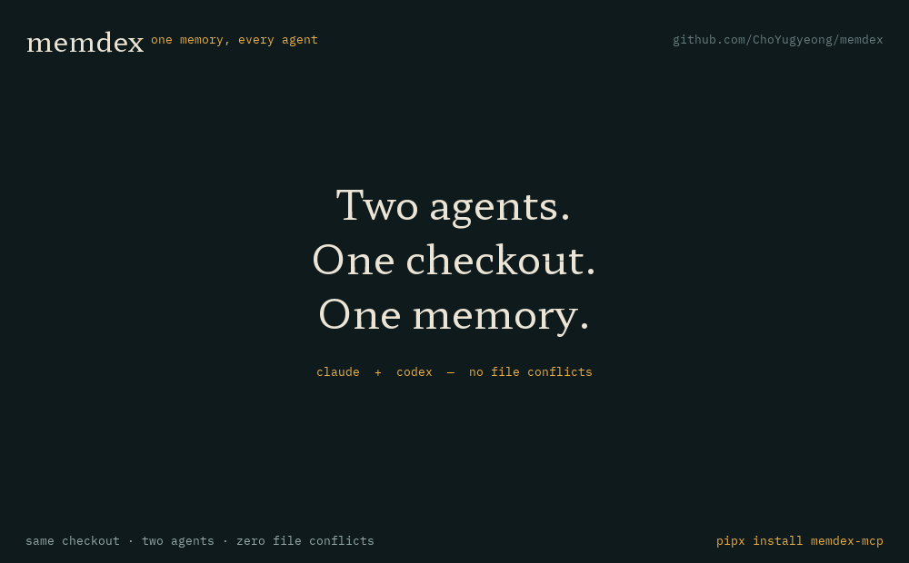

<p align="center">
  
</p>

<h1 align="center">memdex</h1>

<p align="center">
  <b>AI 코딩 에이전트들이 함께 쓰는, 토큰을 아끼는 기억 장치.</b><br/>
  SQLite 파일 하나. 의존성 0개. 어떤 MCP 클라이언트든. Claude Code·Codex·Cursor·딥시크가 같은 것을 기억하고, 서로 이야기합니다.
</p>

<p align="center">
  
</p>

<p align="center">
  <a href="https://github.com/ChoYugyeong/memdex/actions/workflows/ci.yml"></a>
  <a href="https://pypi.org/project/memdex-mcp/"></a>
  
  <a href="LICENSE"></a>
  <a href="https://glama.ai/mcp/servers/ChoYugyeong/memdex"></a>
</p>

<p align="center">
  <a href="#빠른-시작">빠른 시작</a> ·
  <a href="#에이전트-모델-추가하기">에이전트·모델 추가</a> ·
  <a href="#동작-원리">동작 원리</a> ·
  <a href="#도구">도구</a> ·
  <a href="#cli">CLI</a> ·
  <a href="#설정">설정</a> ·
  <a href="#다른-도구와의-비교">비교</a> ·
  <a href="#자주-묻는-질문">FAQ</a> ·
  <a href="README.md">English</a>
</p>

---

새 세션은 매번 백지에서 시작합니다. 같은 3천 토큰짜리 파일을 다시 읽고, 같은 검색을 다시 하고, 이미 겪은 함정을 또 겪습니다.
그 토큰은 전부 비용입니다. 한 컴퓨터에서 여러 에이전트가 일하면 서로 무엇을 알아냈는지, 지금 같은 파일을 고치고 있는지도 모릅니다.

memdex는 이 두 가지를 고치는 작은 MCP 서버입니다.

- **한 번 쓴 파일 요약은 그 파일의 내용이 바뀌기 전까지 유효합니다.** 요약을 경로가 아니라 내용의 sha256에 묶어 두기 때문입니다.
  다음 세션(또는 다른 에이전트)은 3천 토큰짜리 파일 대신 100토큰 요약을 받고, 내용이 바뀌는 순간 "낡았다"는 표시를 봅니다.
- **노트가 스스로 낡음을 압니다.** 결정·함정·핸드오프는 근거가 된 파일을 함께 기록하고, 그 파일이 바뀌면 경고가 붙습니다.
- **에이전트끼리 조율합니다.** 수정 중인 파일을 `claim`하고, 다른 에이전트에게 `post`하고, `inbox`를 읽고, 다음 사람을 위해 `handoff`를 남깁니다.
  한 저장소의 모든 worktree가 같은 기억을 씁니다.

```text
$ memdex file src/store.py
src/store.py · python · 444 lines · sha 3adeaf13
summary (claude@memdex, 2h ago, matches current content):
SQLite 저장소. 테이블: files, summaries(sha 기준), symbols, notes, messages, claims, fts.
index()는 stat이 그대로면 파일을 읽지 않는다. search()는 FTS5와 임베딩을 RRF로 합친다.
outline: class Store:53; method Store.index:101; method Store.search:280; …
```

이 응답은 1.5KB, 원본 파일은 22KB입니다. 이 응답을 만드는 데 모델은 전혀 쓰이지 않았습니다.

실제 66파일 사이트 저장소에서 `memdex bench`로 재보면 파일을 전부 읽는 데 **154,105 토큰**, 개요로는
**3,471 토큰** — 요약을 하나도 저장하지 않은 상태에서 98% 작습니다. 우리 저장소에서 직접
`memdex bench`를 돌려 보세요. 토큰은 `글자 수 / 4` 추정치이고, 중요한 건 절대값이 아니라 비율입니다.

## 빠른 시작

```bash
pipx install memdex-mcp        # PyPI 이름은 memdex-mcp, 명령은 memdex
memdex connect --agent claude  # 이 컴퓨터에 설치된 에이전트 설정에 MCP 항목을 직접 씁니다
```

**Claude Code** (사용자 범위, 모든 프로젝트) — `claude` CLI가 PATH에 있으면 `memdex connect`가 이 명령을
대신 실행하고, 없으면 출력합니다:

```bash
claude mcp add memdex --scope user -e MEMDEX_AGENT=claude -- memdex serve
```

**설정 파일을 쓰는 나머지 클라이언트** (Claude Desktop, Cursor, VS Code·GitHub Copilot, Windsurf, Zed,
Cline, Gemini CLI, Codex CLI): `memdex connect`가 이미 설치된 클라이언트만 골라 `mcpServers.memdex`
항목을 합쳐 넣고(VS Code는 `servers.memdex` + `type: stdio`, Zed는 `context_servers.memdex`, Codex는
`[mcp_servers.memdex]`), 파일의 나머지는 그대로 둡니다. 쓰기 전에 `.bak`을 남기고, 설치되지 않은
클라이언트의 설정 폴더는 만들지 않으며, 읽을 수 없는 파일은 손대지 않고 그대로 둡니다. Zed의
settings.json은 주석을 허용하는데 다시 쓰면 주석이 사라지므로, 주석이 있는 파일은 덮어쓰지 않고
붙여 넣을 블록만 출력합니다. `--list`는 아무것도 쓰지 않고 설치·설정 상태만 보여 주고,
`--dry-run`은 쓸 내용만, `--remove`는 항목을 다시 뺍니다.

**`--serve-check`**는 설정의 마지막 확인입니다. 방금 쓴 항목으로 서버를 직접 띄워 MCP 핸드셰이크
(initialize → `tools/list`)를 해 보고, 경로가 틀렸거나 인터프리터가 없거나 DB를 못 열면 에이전트에
들어가기 전에 여기서 잡습니다:

```text
+ serve-check      memdex answered: 13 tools, protocol 2024-11-05
```

**MCP가 없어도 되는 모델** — MCP 클라이언트는 `memdex connect`로, 셸 명령만 실행할 수 있는 모델은 설정
없이 합류합니다. 두 방법 모두 [에이전트·모델 추가하기](#에이전트-모델-추가하기)에 있습니다.

**팀 범위** — 저장소 안에 설정을 넣어, 클론한 사람 모두가 memdex를 갖게 합니다:

```bash
memdex connect --project     # .vscode/mcp.json, .mcp.json (커밋해도 되도록 `memdex`만 적음)
```

커밋되는 설정에는 이 컴퓨터의 절대경로를 넣을 수 없어서, 프로젝트 범위는 `command`를 `memdex`로 씁니다.
동료의 PATH에 `memdex`가 있어야 하므로 `pipx install memdex-mcp`를 안내하세요. `claude` CLI가 있고
`--project`를 쓰면 `.mcp.json`은 CLI가 직접(`claude mcp add memdex --scope project …`) 쓰고 memdex는
VS Code 파일만 씁니다. 한 파일을 두 주인이 건드리지 않게 하기 위해서입니다. `--no-claude`는 CLI를 건너뛰고,
`--client claude-code`는 그 단계만 실행합니다.

**손으로 넣거나**, memdex가 모르는 클라이언트라면:

```json
{ "mcpServers": { "memdex": { "command": "memdex", "args": ["serve"], "env": { "MEMDEX_AGENT": "codex" } } } }
```

에이전트마다 다른 `MEMDEX_AGENT` 이름을 줍니다. 전체 id는 `이름@체크아웃폴더`(예: `claude@myrepo-wt`)가 됩니다.
`memdex config --agent <이름>`이 위 설정과, 세션 시작 때 브리핑을 자동으로 넣어 주는 Claude Code `SessionStart` 훅을 출력합니다.

끝입니다. 서버가 MCP `initialize` 응답에 사용법을 실어 보내므로, 에이전트는 별도 프롬프트 없이도
브리핑 → 읽기 전 `file_summary` → `remember` → `handoff` 흐름을 압니다.

## 에이전트·모델 추가하기

MCP 지원 여부와 상관없이 모든 에이전트는 같은 네 단계로 루프에 합류합니다:

1. **이름을 줍니다.** `MEMDEX_AGENT`가 id가 됩니다(`이름@체크아웃폴더`). 같은 이름을 쓰는 두 에이전트는
   서로의 메시지를 볼 수 없으니, 각자 다른 이름을 주세요.
2. **연결합니다.** MCP 클라이언트는 명령 하나(아래 표). 셸 명령만 실행할 수 있는 모델은 연결할 것이 없습니다.
3. **확인합니다.** `memdex doctor`(`✓ clients`), Codex는 `codex mcp list`, 핸드셰이크는
   `memdex connect --serve-check`, 그 외에는 `memdex whoami`.
4. **일합니다.** 어떻게 합류했든 네 동사는 같습니다: `brief`, `claim`, `post`/`inbox`, `handoff`.

| 에이전트 / 모델 | 합류 방법 | 확인 |
|---|---|---|
| Claude Code | `memdex connect`(`claude mcp add …` 실행) + `SessionStart` 훅 | `claude mcp list` |
| Codex CLI | `memdex connect` → `~/.codex/config.toml`의 `[mcp_servers.memdex]` | `codex mcp list` |
| Claude Desktop, Cursor, VS Code, Windsurf, Zed, Cline, Gemini CLI | `memdex connect`가 각 설정 파일에 키 하나씩 기록 | `memdex doctor` |
| **셸 명령만 실행할 수 있는 모든 모델** — 로컬 LLM, 래퍼 스크립트, 다른 하네스 | 연결 불필요: `MEMDEX_AGENT`만 주고 네 동사 호출 | `memdex whoami` |

```bash
# MCP 클라이언트가 없는 모델도 10초면 합류
MEMDEX_AGENT=codex memdex brief                    # 이전 세션이 남긴 것
MEMDEX_AGENT=codex memdex claim src/store.py --intent "add retry"
MEMDEX_AGENT=codex memdex post "src/api.py는 제가 합니다" --to claude
MEMDEX_AGENT=codex memdex handoff "retry 완료" --next "timeout 연결"
```

`memdex connect --project`는 설정을 저장소에 넣어, 클론한 동료도 memdex를 갖게 합니다.

## 동작 원리

```text
          에이전트 (Claude Code, Codex, Cursor, DeepSeek, …)
               │ MCP stdio        │ CLI
               ▼                  ▼
        ┌──────────────── memdex ────────────────┐
        │ project_brief · file_summary · where_is │
        │ read_snippet · search · remember        │
        │ handoff · post/inbox · claim            │
        ├─────────────────────────────────────────┤
        │ 증분 색인            개요 + 심볼         │   크기·수정시각이 바뀐
        │ (stat → sha256)      (regex/ast, LLM 無) │   파일만 다시 읽음
        ├─────────────────────────────────────────┤
        │ sha256에 묶인 요약                       │   내용이 바뀌기 전까지 유효
        │ 파일 참조가 있는 노트 → 낡음 표시        │
        │ 메시지, 읽음 커서, 만료되는 claim        │
        ├─────────────────────────────────────────┤
        │ SQLite WAL · FTS5 trigram · 벡터        │   ~/.memdex/memdex.db
        └─────────────────────────────────────────┘
```

| | 무엇을 하나 | 가져온 발상 |
|---|---|---|
| **내용 해시 요약 캐시** | 요약은 파일의 sha256 아래 저장됩니다. 다른 worktree·브랜치의 같은 내용은 요약을 공유하고, 바뀐 내용에는 "아직 요약 없음, 옛 요약과 개요는 이것"이 나옵니다. | 내용 주소 저장소 |
| **증분 색인** | `git ls-files`(`.gitignore` 존중) 뒤, 크기나 수정시각이 바뀐 파일만 읽습니다. 800개 파일 저장소 재색인이 약 0.2초입니다. | [Everything](https://www.voidtools.com/)의 USN 저널 방식 |
| **개요 + 심볼 지도** | 독스트링/첫 주석과 클래스·함수·줄 번호를 30여 언어에서 뽑습니다(파이썬은 `ast`, 나머지는 언어별 정규식 — tree-sitter나 파서 설치 없음). `where_is`가 grep 반복을 대신합니다. | Serena / repo map |
| **부분 읽기** | `read_snippet`은 파일 전체 대신 검색어나 줄 번호 주변 약 256토큰만 돌려줍니다. | [Kensaku](https://github.com/yjid/kensaku) |
| **낡음을 아는 노트** | `remember`가 노트를 파일에 묶고, `search`와 `project_brief`가 파일이 바뀌면 "⚠ 이후 변경됨"을 보여 줍니다. 노트는 추가만 하므로(`supersedes`) 동시에 써도 서로 덮어쓰지 않습니다. | Basic Memory, mem0 |
| **에이전트 조율** | 만료 시간이 있는 `claim`과 겹침 경고, 에이전트별 읽음 커서가 있는 `post`/`inbox`, 다음 세션이 가장 먼저 보는 `handoff`. | — |
| **하이브리드 검색** | FTS5 trigram(한국어·일본어·중국어 지원, 두 글자 단어는 LIKE로 보완)과 선택적 로컬 임베딩을 RRF로 합칩니다. | claude-context |
| **컴퓨터 전체 내용** | [Kensaku](https://github.com/yjid/kensaku)가 설치돼 있으면 `search`가 PDF·오피스 문서·스크린샷(OCR)·의미 검색 결과도 함께 돌려줍니다. | Kensaku |

개요 지원 언어: Python, JavaScript/TypeScript, Vue, Svelte, Go, Rust, Java, Kotlin, Scala, C#, Swift, Dart, C, C++,
Ruby, PHP, Lua, GDScript, Elixir, Clojure, Zig, Julia, R, Haskell, Groovy, Protobuf, GraphQL, SQL, 셸, PowerShell, Markdown.

## memdex는 무엇을 먼저 기억하고, 무엇을 잊나

기억은 늘어나기만 하면 없는 것과 같습니다. 브리핑은 수백 개 중 몇 줄을 골라야 하니까요. 그래서 모든 노트에
**활성도(activation)** 를 매깁니다. ACT-R의 기저 학습 모형대로 사용할 때마다 `t^-0.5`를 더한 값입니다. 지난주에
다섯 번 읽힌 노트가 어제 쓰이고 한 번도 안 읽힌 노트보다 위에 옵니다. pitfall·decision에는 가중치를 주고
(무시할 때 손해가 더 크므로), `--importance`로 더 올릴 수 있습니다.

여기서 세 가지가 따라옵니다.

- **고정 핵심(`--pin`)**: 모든 브리핑 맨 위의 작은 고정 자리. 모든 세션이 반드시 봐야 하는 사실을 담습니다 —
  에이전트들이 스스로 쓰는 시스템 프롬프트인 셈입니다.
- **콜드 계층**: 활성도 −3 아래로 내려간 노트는 저장·검색은 그대로 되지만 브리핑과 기본 검색 예산을 쓰지
  않습니다. 삭제되지 않고, `search`로는 여전히 찾힙니다. 여기서 활성도는 *인출* 강도입니다. 계속 confirm을
  받아온 노트는 *저장* 강도가 높아서, 한동안 쓰이지 않았어도 브리핑에 남습니다(Bjork & Bjork 1992) — 마흔
  번의 세션이 쓴 결정을 이번 달에 안 썼다는 이유로 버리지 않습니다.
- **간섭**: 어떤 노트가 supersede되면, 그 노트와 같은 파일을 다루는 살아있는 노트들이 조금 낮게 정렬됩니다.
  이미 그중 하나가 틀렸다는 게 밝혀졌기 때문입니다(인출 유발 망각, Anderson, Bjork & Bjork 1994). 숨기지는
  않고 순위만 낮춥니다.
- **재공고화**: 노트가 가리키는 파일·심볼이 바뀌면 `note`가 `⚠ 이후 변경됨`을 보여 주고,
  `note(id, "confirm")`이 참조를 현재 코드로 다시 도장 찍습니다. 확인 자체가 사용이라 활성도도 올라갑니다
  (인출 연습 효과).

낡음은 파일 단위가 아니라 **심볼 단위**로 봅니다. `Store.claim`에 대한 노트는 그 함수가 바뀔 때 낡고, 같은 파일의
다른 함수가 바뀔 때는 최신입니다.

노트를 저장할 때는 같은 프로젝트의 활성 노트와 64비트 SimHash(단어 n-gram)로 비교해, 거리 12비트 이내면
"#17과 비슷합니다 — 대체하려면 supersedes로" 하고 알려 줍니다. 결정은 에이전트가 하고, memdex가 기억을
임의로 합치지는 않습니다.

## 도구

| 도구 | 언제 | 무엇을 받나 |
|---|---|---|
| `project_brief` | 세션 시작 | 마지막 핸드오프, 함정, 결정, 할 일, 안 읽은 메시지, 누가 무엇을 고치는지. 색인도 갱신. |
| `file_summary` | 파일을 읽기 전 | 내용이 그대로면 캐시된 요약, 아니면 옛 요약(낡음 표시)과 무료 개요. |
| `file_summary_save` | 파일을 읽은 뒤 | 2~6줄 요약을 내용 해시에 묶어 모두와 공유. |
| `where_is` | "X가 어디 정의돼 있지?" | `경로:줄 종류 이름` 목록. |
| `read_snippet` | 파일의 일부만 읽을 때 | `query`나 `line` 주변의 제한된 조각. |
| `search` | 처음부터 탐색하기 전 | 노트·핸드오프·요약을 키워드+의미로, Kensaku가 있으면 그 결과도. |
| `remember` / `note` | 뻔하지 않은 것을 알았을 때 | `note`·`decision`·`pitfall`·`todo` 저장/읽기/보관, 파일 연결 가능. |
| `handoff` | 세션 끝 | 한 일 / 다음 / 결정 / 함정. claim도 해제. |
| `post` / `inbox` | 다른 에이전트와 대화 | 전체 또는 `to: "deepseek"`; `inbox`는 `peek`이 아니면 읽음 처리. |
| `claim` | 수정 전 | 경로를 N분간 선언; 다른 에이전트의 겹치는 claim을 경고. |

도구 스키마 12개가 요청당 약 1,000토큰입니다. 응답은 짧은 일반 텍스트입니다. 바이트 하나하나가 토큰이니까요.

## CLI

도구가 하는 일은 전부 명령으로도 됩니다. 셸만 쓰는 에이전트, 훅, 사람을 위한 것입니다.

```bash
memdex brief --agent codex              # 세션 시작
memdex file src/store.py                # 캐시된 요약 + 개요
memdex file src/store.py --summary "…"  # 요약 저장
memdex snippet src/store.py --query "def index"
memdex where_is index                   # 심볼 정의 위치
memdex search "locked"
memdex remember pitfall "WAL 모드 필요" --body "…" --files src/store.py
memdex remember decision "sqlite만 쓴다" --importance 3 --pin
memdex claim src/store.py --intent "리팩터링"
memdex claim src/store.py --exclusive  # 잠금: 다른 에이전트의 claim이 거부됩니다
memdex post "store.py는 한 시간 동안 제가 고칩니다" --to claude
memdex inbox
memdex inbox --follow                    # 다음 메시지가 올 때까지 대기 (우편함 폴링, --timeout N)
memdex whoami                            # 나는 누구고 어느 체크아웃인지, 뭐가 기다리는지 (인덱스 패스 없이)
memdex session list                      # 살아 있는 세션 목록 (브리프가 하트비트)
memdex wake --agent claude --command "claude -p 'check the brief'"   # 기다리는 일이 있으면 새 세션 열기
memdex contradictions                    # 서로 반대로 주장하는 노트 — 편집 전에 정리하세요
memdex digest                            # 같은 말을 두 번 하는 노트 묶음 (통합용)
memdex skills suggest docs/*.docx deck/  # 지금 만질 파일에 맞는 공유 스킬 찾기
memdex skills recommend office slides    # 이 프로젝트의 스킬 → .memdex/skills.json (커밋해서 공유)
memdex note 7                            # 읽기
memdex note 7 --confirm                 # 지금도 유효: 참조 재도장, ⚠ 제거
memdex note 7 --pin                     # 브리핑 맨 위에 고정
memdex note 7 --archive                 # 노트 읽기, 또는 보관
memdex handoff "X 완료" --next "Y" --pitfalls "Z"
memdex index                            # 현재 프로젝트 색인 갱신
memdex export --out notes/              # 노트를 마크다운 파일로
memdex export --sync ../shared          # 노트·요약을 JSON으로 (다른 컴퓨터로 옮길 때)
memdex merge ../shared                  # 다른 컴퓨터가 export한 것을 적용 (updated_at 기준 LWW)
memdex digest                           # 같은 말을 하는 노트들 → 에이전트가 통합
memdex import                           # AGENTS.md / CLAUDE.md를 노트로 읽기 (콜드 스타트)
memdex stats
memdex bench                            # 이 저장소에서 개요가 아끼는 토큰 측정
memdex prune --dry-run                  # 사라진 프로젝트의 색인 행 정리(미리보기)
memdex doctor                           # DB·스키마·색인·선택 기능 점검
memdex doctor --serve-check             # …서버를 띄워 MCP 핸드셰이크까지 확인
memdex connect --agent claude           # 설치된 클라이언트 설정에 MCP 항목 쓰기
memdex hook install                     # git pre-commit: 잠긴 파일 커밋 거부
memdex skills                           # 이 컴퓨터의 에이전트들이 공유하는 스킬
memdex skills scan                      # SKILL.md 파일을 다시 읽어 등록
memdex skills show deploy               # 스킬 하나를 출력해 에이전트가 따라 할 수 있게
```

## 잠금과 공유 체크아웃

서로 협조하는 에이전트끼리는 일반 claim으로 충분하지만, `git commit`은 막지 못합니다. 두 명령이 그 틈을
메웁니다.

```bash
memdex claim src/store.py --exclusive --intent "재시도 루프 재작성"
memdex hook install
```

`--exclusive`는 claim을 잠금으로 만듭니다. 그 경로에 대한 다른 에이전트의 claim이 거부되고, 잠금이 살아
있는 동안 그들의 커밋도 거부됩니다. `--force`를 주면 잠금을 무시하고 기록하며, 상대에게 그 사실을 알립니다.
모든 claim은 만료되므로 세션이 죽어도 영원히 잠기지 않습니다.

`memdex hook install`은 `.git/hooks/pre-commit`에 `memdex hook pre-commit`을 부르는 작은 `sh` 스크립트를
심습니다. 스테이징된 파일만 검사하고, 로컬 DB만 읽습니다.

```
$ git commit -m "재시도 루프"
memdex: commit blocked — these staged files are locked by another agent:
  src/store.py  ←  claude@memdex (재시도 루프 재작성, 41m left)
```

일반 claim은 커밋을 막지 않고 안내만 출력합니다. 낡은 잠금이라고 확신하면
`MEMDEX_ALLOW_LOCK=1 git commit …`으로 건너뛸 수 있고, memdex가 만들지 않은 훅은 `hook install --force`로
교체합니다.

그런데 커밋 시점은 늦습니다. 그때는 이미 파일이 바뀐 뒤니까요. 도구 실행 전 훅이 있는 하네스라면 **편집
자체를** 막을 수 있습니다. Claude Code는 `PreToolUse` 훅을 제공합니다.

```bash
memdex hook install --claude            # ~/.claude/settings.json
memdex hook install --claude --project  # ./.claude/settings.json
```

```json
{"hooks": {"PreToolUse": [{"matcher": "Edit|Write|MultiEdit",
  "hooks": [{"type": "command", "command": "memdex hook pre-edit --agent claude"}]}]}}
```

이 훅은 Claude Code가 stdin으로 주는 JSON에서 `tool_input.file_path`를 읽어 프로젝트 상대 경로로 바꾸고,
다른 에이전트가 그 파일을 exclusive claim으로 잡고 있으면 **exit 2**(차단, stderr는 모델에게 전달)로
멈춥니다.

```
blocked: locked by deepseek@memdex (refactor, 40m left) — post to them or claim --force
```

일반 claim이면 안내만 출력하고 편집은 통과합니다. 프로젝트 밖 경로는 무시하고, `MEMDEX_ALLOW_LOCK=1`로
우회할 수 있습니다. 설치 프로그램은 기존 `settings.json`에 **병합**하며(변경 전 `.bak` 백업), 읽을 수 없는
파일은 건드리지 않습니다. `memdex config`도 같은 스니펫을 출력합니다.

잠금은 **번호가 붙은 임차(lease)** 입니다. 모든 부여는 fencing token과 그 시점 파일의 sha를 함께 기록하므로,
잠금이 이전 것과 구분되고 **낡은 읽기로 계산한 편집은 덮어쓰지 않고 거부**됩니다:

```
blocked: src/store.py changed since you claimed it (token 7, sha 3adeaf13 → b71f0c92).
Re-read the file, then re-stamp the lock:
  memdex claim src/store.py --exclusive --refresh
```

`--refresh`는 내가 이미 가진 잠금만 다시 도장 찍습니다(새 토큰, 현재 sha). 새 잠금을 잡지도, 남의 잠금을
덮지도 않습니다.

## 내 저장소에서 직접 재보기

가장 먼저 나오는 질문은 "그래서 얼마나 아끼나요?"입니다. 직접 재보세요.

```bash
cd your-repo && memdex bench
```

```
your-repo: 812 files · 3.4 MB indexed in 0.21s (812 changed)
reading every file whole: ~871,000 tokens
outline instead:          ~96,120 tokens  (89% smaller; 640 files have symbols)
biggest wins (file → outline):
  src/generated/api.ts                            144.0 KB →    1.6 KB  ( 99% smaller)
  src/store.ts                                     22.2 KB →    1.0 KB  ( 95% smaller)
```

토큰은 `글자 수 / 4`로 추정합니다. 절대값보다 비율이 핵심이고, 에이전트가 실제 2~6줄 요약을 저장하면
`file_summary`는 더 작아집니다. 스크립트용으로는 `--json`을 쓰세요.

## 유지보수

DB 파일 하나를 컴퓨터의 모든 프로젝트가 공유하므로 계속 자랍니다. `memdex prune`은 더 이상 존재하지 않는
프로젝트 디렉터리의 색인·검색 행을 지우고 VACUUM합니다.

```bash
memdex prune --dry-run     # 무엇이 지워질지 미리 보기
memdex prune               # 사라진 파일 색인 정리 + VACUUM
memdex prune --all         # 없는 프로젝트의 노트·메시지·클레임까지 삭제(되돌릴 수 없음)
```

## 설정

| 변수 | 기본값 | 의미 |
|---|---|---|
| `MEMDEX_AGENT` | `agent`(또는 MCP 클라이언트 이름) | 이 에이전트의 이름. 노트·메시지·claim에 표시됩니다. |
| `MEMDEX_HOME` | `~/.memdex` | `memdex.db` 위치. 저장소 안에는 아무것도 쓰지 않습니다. |
| `MEMDEX_PROJECT` | 현재 폴더 | 서버를 프로젝트 밖에서 띄울 때의 프로젝트 루트. |
| `MEMDEX_EMBED` | 꺼짐 | `ollama:<모델>`로 의미 검색을 켭니다. 예: `ollama:bge-m3`(다국어). |
| `MEMDEX_OLLAMA_URL` | `http://localhost:11434` | Ollama 주소. 연결이 안 되면 조용히 키워드 검색으로 돌아갑니다. |
| `MEMDEX_KENSAKU` | PATH의 `kensaku-cli` | Kensaku CLI 경로, 또는 `off`. |

**절대 읽지 않는 것:** 비밀로 보이는 파일(`.env*`, `*.pem`, `*.key`, `*secret*`, `*credential*`, `.npmrc` 등), 바이너리, 락 파일,
512KB 넘는 파일, git이 무시하는 파일.

**프로젝트 식별:** git common 디렉터리. 한 저장소의 모든 worktree가 노트·메시지·claim을 공유하고, 파일 색인은 worktree별로 둡니다.

## 한계 (도입 전에 읽어 주세요)

memdex가 아닌 것을 분명히 해 둡니다. 각 항목을 어떻게 고칠 수 있는지, 어떤 논문·알고리즘이 가장 싼
정공법인지는 [docs/LIMITS.md](docs/LIMITS.md)에 정리해 두었습니다.

- **벤치 기준선은 후합니다.** `memdex bench`는 "모든 파일을 통째로 읽기"와 "개요 보기"를 비교합니다. 실제 에이전트는
  grep과 부분 읽기를 하므로 체감 절감은 98%보다 작습니다. 대신 `memdex stats`가 사용 기반 수치(fresh로 받은 요약,
  다음 세션이 읽은 노트, cold 노트)를 보여 주며 그게 정직한 숫자입니다. 확실한 이득은 같은 파일, 같은 심볼, 같은 함정을
  두 번 다시 발견하지 않는다는 점입니다.
- **기계 사이 공유는 없습니다.** SQLite 파일 하나, 로컬 전용. 팀 동기화·클라우드·SSO는 없습니다(의도된
  트레이드오프지만, 팀 지식베이스를 대체하지는 못합니다).
- **잠금은 memdex에 물어보는 곳에서만 강제됩니다. 파일 시스템 수준이 아닙니다.** `claim(exclusive=true)`는 다른
  에이전트의 claim을 거부하고, `pre-edit` 훅(Claude Code)은 편집을, pre-commit 훅은 커밋을 거부합니다. 하지만
  memdex가 보지 못하는 경로로 쓰는 것(훅 없는 세션, 체크아웃 밖을 고치는 도구)은 여전히 막지 못합니다. 진실의
  원천은 git입니다.
- **메시지는 푸시가 아니라 우편함입니다.** `post`는 DB에 쓰고, 받는 쪽이 다음 `inbox`/`brief`에서 봅니다.
  세션이 꺼져 있으면 알림이 갈 수단이 없으므로(세션이 없을 때 memdex 안에서 도는 것은 없음) `post`가
  "전달됨/대기 중"을 구분해 알려 주고, 기다리려면 `inbox --follow`를 씁니다. 두 세션은 `MEMDEX_AGENT`를
  반드시 다르게 주세요 — 같은 id면 inbox가 보낸 사람과 받는 사람을 구분할 수 없습니다.
- **아주 작은 저장소에는 필요 없을 수 있습니다.** 20파일 이하라면 손으로 쓴 `AGENTS.md`가 더 쌉니다.
- **거대한 체크아웃에서는 첫 브리핑이 부분적입니다.** 색인은 파일당 0.4ms 정도(2만 파일 ≈ 8초)지만,
  윈도우에서는 백신이 새 파일을 처음 읽을 때 훨씬 비싼 비용을 치릅니다. 그래서 브리핑은 한 번에
  `INDEX_BUDGET`(2,000)개 파일까지만 색인하고 남은 개수를 알려 주며, 다음 브리핑이 이어서 처리합니다.
  `memdex index`는 상한이 없고, `MEMDEX_INDEX_BUDGET=0`이면 브리핑의 상한도 사라집니다.
- **아직 젊습니다.** 유지보수자 1명. 스키마 v5이며 이전 모든 버전에서 제자리 마이그레이션됩니다. 더 새로운 memdex가 쓴
  DB는 조용히 덮어쓰지 않고 거부합니다. 거친 부분이 있을 수 있습니다.
- **개요는 정규식 수준입니다.** Python은 `ast`, 나머지는 언어별 정규식이라 일반적인 코드에는 잘 맞고
  특이한 문법에서는 가끔 놓칩니다. `where_is`는 부분 문자열 검색으로 폴백합니다.

## 다른 도구와의 비교

memdex는 일부러 작게 만들었습니다. 아래 도구들은 memdex가 하지 않는 일을 잘하고, 여럿은 memdex에 영감을 주었습니다.

| | 초점 | 의존성 | 관계 |
|---|---|---|---|
| **memdex** | 세션·에이전트를 가로지르는 기억: 내용 해시 요약, 낡음을 아는 노트, 조율 | 없음 | — |
| [Serena](https://github.com/oraios/serena) | 언어 서버를 통한 정밀한 심볼 탐색과 편집 | 언어별 LSP 서버 | 같이 씁니다. 편집은 Serena, 기억은 memdex. memdex의 `where_is`는 정규식 수준의 대용품입니다. |
| [Basic Memory](https://github.com/basicmachines-co/basic-memory) | 노트 그래프가 있는 마크다운 지식 베이스 | 파이썬 패키지, 프로젝트 안의 마크다운 | memdex는 노트를 저장소 밖에 두고 파일 해시에 묶습니다. |
| [mem0](https://github.com/mem0ai/mem0) | LLM 앱용 기억 계층, 호스팅 또는 자체 운영 | 벡터 DB / LLM | memdex는 로컬 전용이고 한 컴퓨터의 코딩 에이전트가 대상입니다. |
| [claude-context](https://github.com/zilliztech/claude-context) | 코드베이스 벡터 검색 | Milvus/Zilliz, 임베딩 API | memdex는 노트와 요약을 검색하고, 코드는 키워드+심볼로, 원하면 Ollama 임베딩으로. |
| [Kensaku](https://github.com/yjid/kensaku) | 데스크톱 검색: 파일 이름, PDF/오피스 본문, OCR, 의미 검색 | Rust 데스크톱 앱 | 보완 관계. memdex가 컴퓨터 전체 내용 검색을 Kensaku에 넘깁니다. |

## 자주 묻는 질문

**밖으로 나가는 게 있나요?** 없습니다. SQLite 파일, 로컬 서브프로세스, 선택적 로컬 Ollama뿐입니다. 텔레메트리도 없습니다.

**요약은 누가 쓰나요?** 에이전트가, 요약이 없는 파일을 읽은 뒤에 씁니다. 서버 안내문이 2~6줄을 요청합니다.
사람이 직접 써도 됩니다: `memdex file 경로 --summary "…"`.

**두 에이전트가 같은 파일을 고치면요?** `claim`은 경고할 뿐 잠그지 않습니다. memdex는 조율을 돕지, git을 대신하지 않습니다.

**컨텍스트를 얼마나 쓰나요?** 요청당 도구 스키마 약 1,000토큰, `project_brief`에 몇백 토큰(4,000자 상한,
`memdex brief --max-chars 0`이면 전부). 파일 하나를 다시 안 읽는 순간 본전입니다.

**뭔가 안 되는데 뭘 돌려 보나요?** `memdex doctor`. DB 경로·크기·스키마 버전, 쓰기 가능 여부, 현재
프로젝트 색인 여부, 어떤 에이전트에 MCP 항목이 들어가 있는지, 선택 기능(Kensaku·Ollama) 상태를 한 번에
보여 줍니다. `--serve-check`를 붙이면 에이전트가 실행할 방식으로 서버를 직접 띄워 MCP 핸드셰이크까지
확인하므로, "설치됐는데 시작이 안 되는" 상태가 미스터리가 아니라 ✗로 드러납니다:

```text
✓ serve-check     memdex answered: 13 tools, protocol 2024-11-05
```

**기억을 보거나 고칠 수 있나요?** `memdex export`가 노트를 마크다운 파일로 씁니다. DB는 그냥 SQLite입니다. 처음부터 다시 하려면 `~/.memdex`를 지우면 됩니다.

**벡터 DB만 쓰면 안 되나요?** 코드는 정확한 이름 일치가 임베딩보다 낫고, 임베딩은 노트를 어렴풋이 기억할 때 좋습니다.
memdex는 기본이 키워드+심볼이고, 켜면 벡터를 더합니다.

## 브랜드

아이덴티티는 **Ledger Ribbon** — 파일에 꽂아 둔 북마크, Hahmlet 세리프, 밤의 원장 잉크 위에 앰버 룰 하나.

- 로고: [`logo.svg`](docs/brand/logo.svg) · 다크 지면: [`logo-on-dark.svg`](docs/brand/logo-on-dark.svg) · 심볼: [`symbol.svg`](docs/brand/symbol.svg)
- 색: Ledger Ink `#0e1a1c` · Lamp Amber `#f0b03f` · Bone `#ece5d6`
- 타입: Hahmlet(디스플레이) · Gothic A1(본문) · Nanum Gothic Coding(모노) — 모두 OFL 1.1
- 토큰: [`tokens.css`](docs/brand/tokens.css) · 가이드라인: [`memdex-guidelines.pdf`](docs/brand/memdex-guidelines.pdf)(13페이지) · 설명: [`docs/brand/`](docs/brand/README.md)

## 기여

```bash
git clone https://github.com/ChoYugyeong/memdex && cd memdex
pip install -e .
python -m unittest discover tests     # 363개, 약 35초, 동시성 테스트는 실제 프로세스를 띄움
```

규칙은 짧습니다. 런타임 의존성 금지, 도구 설명은 짧게(매 요청의 토큰입니다), 개요 정규식은 group 1이 심볼 이름.
자세한 내용은 [CONTRIBUTING.md](CONTRIBUTING.md)에 있습니다.

memdex는 Claude Code와 DeepSeek이 같은 체크아웃에서 함께 만들었습니다. 그 조율도 memdex로 했습니다.

## 라이선스

[MIT](LICENSE)


